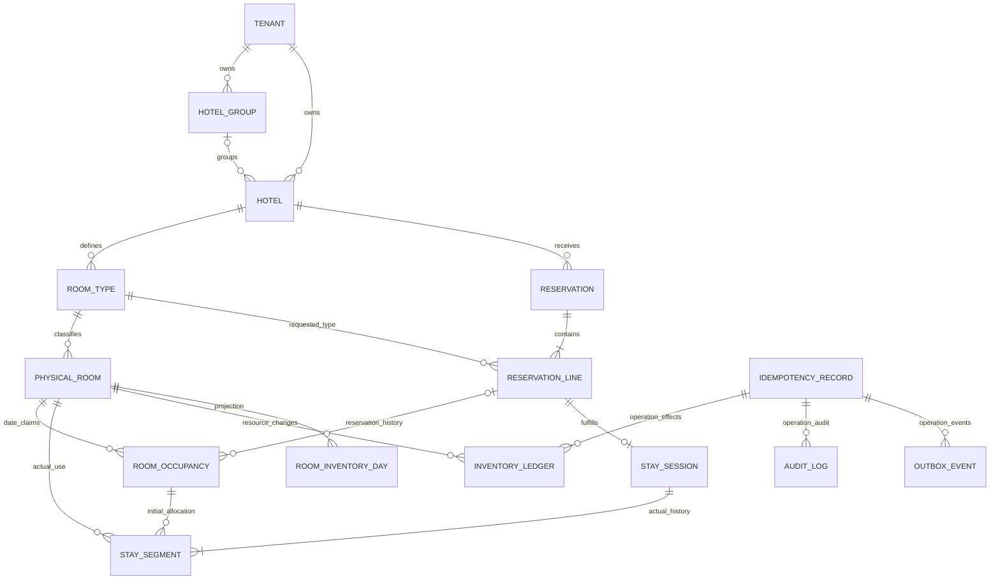

# PMS 交易不变量与数据模型

> 版本：0.1；日期：2026-10-19；任务：S0-04；状态：VERIFYING，候选设计已交付，业务分支及数据库验证未完成。
>
> 输入：[架构](../enterprise_hotel_pms_architecture.md)、[状态机](./state-machines.md)、[业务决定](../requirements/decision-register.md)、[技术基线](../adr/ADR-011-technology-baseline.md)。配套：[数据字典](./data-dictionary.md)、[事务与锁协议](./transaction-boundaries.md)、[验收矩阵](./data-model-scenarios.md)。

## 1. 范围与未决分支

本稿设计组织、房间、订单 O、履约子项 L、实体占用 A、入住会话 S、分段 G、幂等、房晚流水、审计和事件的核心物理关系。它是正式 Flyway 迁移的输入，不是已执行的 DDL。支付、身份、渠道、价格的完整表结构分别留给对应任务，只约定核心引用和事务边界。

分析基线是“同租户同门店下单，一间所购房对应一个 L，预订时内部落实整段实体房”。该基线没有将 DEC-01/03/04/05/16 改为 DECIDED。

| 未决决定 | 本稿支持的候选 | 冻结前限制 / 改选影响 |
| --- | --- | --- |
| DEC-01/02 | 租户为隔离根，集团位于租户内部，门店有显式授权范围 | 品牌不自动授权；跨租户集团汇总须单独授权模型；主体关系改变要重审外键 |
| DEC-03/04 | 一个 O 包含多个单房 L；可以表达不同履约状态 | 是否多房型、独立日期、部分操作由入口能力开关控制，字段能表达不等于允许使用 |
| DEC-05 | 有效 L 对应唯一有效实体 A | 真正未分房需要配额账本与转实体协议，不能简单允许已确认 L 无 A |
| DEC-06/07/16 | 日级 `[入住日,退房日)` 与实际入住时刻分离 | 小时房、床位、同日入住退房、换房切换日、释放生效日未批准时拒绝相关操作；不写空区间规避 |
| DEC-08/09/12 | 资金状态、金额快照、住客信息与占用分离 | 不设虚构币种、税费率或保留天数；真实个人数据进入前完成 S0-08 |

## 2. 核心物理决定与命名迁移

选择**一张 `room_occupancy` 表承载全部互斥日期事实**：`kind=RESERVATION` 为 A，`kind=BLOCK` 为生效维修/停用区间 B。两个类别共享同一条 GiST 排斥约束。这样数据库可以直接阻止预订与封房的交叉重叠；房间行锁继续负责实际入住、清洁等跨对象条件。

这是对原架构概念表的显式收敛，依据 [ADR-001](../adr/ADR-001-inventory-authority.md)、[ADR-002](../adr/ADR-002-room-exclusion.md)：

| 原概念 / 状态机对象 | 候选物理映射 | 保留的职责 |
| --- | --- | --- |
| reservation / O | `reservation` | 归属、订单编号、聚合状态、版本 |
| 新增房间级履约 L | `reservation_line` | 每行数量固定为 1，计划需求、履约状态；不能用 quantity>1 代替部分履约 |
| reservation_room / A | `room_occupancy` 的 RESERVATION 行 | 实体房日期权威；不是销售子项，不另建第二张可写占用事实表 |
| room_block / B | `room_occupancy` 的 BLOCK 行 | 生效封房日期权威；待审批工单不占房，批准后才创建 BLOCKED 行 |
| S / G | `stay_session` / `stay_segment` | 同一履约连续性 / 实际房间使用历史 |
| room_inventory_day | `room_inventory_day` | 当前及未来房态投影，可重建、可丢弃；不用于最终成交裁决 |

若以后保留旧名称用于视图或 API，必须明确只读映射及字段语义。当前仓库没有业务数据迁移证据，因此本稿没有执行改表、搬数据或创建兼容视图。正式迁移前再次核查实际库，不能假设永远为空库。

## 3. ER 关系



ER 图展示概念基数，不能代替条件约束：BLOCK 行不关联 L；一个 L 的 A 历史可有多个，但有效 A 至多一个；L 在住时必须有一个活动 S/G；只有事务检查才能保证 O 至少一个 L 和 S 至少一个 G。详细列、复合 FK 和索引见数据字典。

## 4. 归属、主键与权限

- 业务实体使用数据库生成 `bigint` 主键；API 将大整数标识编码为字符串，避免 JavaScript 精度丢失。事件与操作用不含业务秘密的 UUID；UUID 不作为事件提交顺序。
- 门店业务表统一带 `tenant_id, hotel_id`；被引用对象提供 `UNIQUE(tenant_id,hotel_id,id)`。子表使用完整复合 FK，禁止只检查全局 `id` 而允许伪造冗余归属。
- O→L 使用 `(tenant_id,hotel_id,reservation_id)`；A→L 使用 `(tenant_id,hotel_id,reservation_id,line_id)`，L 提供对应唯一键；A→房间另用完整归属 FK。如此不能把本订单的 A 挂到另一订单的 L。
- 房间→房型和 L→请求房型均使用门店复合 FK。实际房型是否允许升级由政策决定，不强制请求房型与实际房型永远相等；换型保存政策/报价依据。
- `hotel.group_id` 可空；有值时用 `(tenant_id,group_id)` 约束到同租户集团。集团不是跨租户授权捷径。
- 默认删除策略为 RESTRICT/NO ACTION。组织/房间停用使用状态；已有交易不得级联删除。租户、门店及房间归属有业务引用后不允许原地迁移。
- FK 不证明调用者有权操作。服务端从可信身份建立范围，每个查询、更新、导出及幂等回放均重新授权；RLS 是否作为额外层在 S1-03 决定，本稿不假定已启用。

## 5. 占用、版本与实际入住

### 5.1 统一占用约束

以下只是候选约束片段，依赖字典中的 NOT NULL、复合 FK、状态 CHECK 及 `btree_gist` 扩展；未在 PostgreSQL 执行，不是完整建表脚本。

```sql
CHECK (
  NOT isempty(stay_range)
  AND NOT lower_inf(stay_range) AND NOT upper_inf(stay_range)
  AND isfinite(lower(stay_range)) AND isfinite(upper(stay_range))
  AND lower_inc(stay_range) AND NOT upper_inc(stay_range)
  AND lower(stay_range) < upper(stay_range)
);

EXCLUDE USING gist (
  tenant_id WITH =, hotel_id WITH =, room_id WITH =, stay_range WITH &&
) WHERE (status IN ('HELD', 'CONFIRMED', 'CHECKED_IN', 'BLOCKED'));

CREATE UNIQUE INDEX uq_one_effective_allocation_per_line
ON room_occupancy (tenant_id, hotel_id, line_id)
WHERE kind = 'RESERVATION'
  AND status IN ('HELD', 'CONFIRMED', 'CHECKED_IN');
```

`stay_range`、kind、status 和资源归属必须 NOT NULL。类型/状态校验规定：RESERVATION 只允许 A 的七个状态，要求 reservation_id/line_id 非空；BLOCK 只允许 BLOCKED/UNBLOCKED，要求两个预订引用为空且封房原因非空。封房终结保留原区间及原因；维修工单的处理状态另行建模，不扩大占用有效集合。

HELD 即使超过 expires_at 仍参与约束，只有事务化 ExpireHold 才释放。索引谓词不使用 `now()`。一个维修区间与另一个重叠维修区间也被拒绝；多张工单可以归并到同一不可售事实，不能重复占用再重复释放。如果业务要求多层独立封锁原因，需另做原因集合与区间合并模型。

PostgreSQL 的范围类型支持重叠算子和排斥约束；`daterange` 会规范化边界，API 仍须拒绝不符合业务合同的输入，不能依靠规范化“修正”错误入住/退房日期。CHECK 只用于本行条件，跨行/跨表关系使用 FK、唯一/排斥约束及事务协议。[范围类型](https://www.postgresql.org/docs/17/rangetypes.html)、[约束说明](https://www.postgresql.org/docs/17/ddl-constraints.html)。

### 5.2 后继版本与当前关系

- 不保存容易漂移的 `L.current_occupancy_id`。按 L 和有效状态查询 A，由部分唯一索引保证“至多一个”；合法 L “必须恰好一个”由同事务提交前检查及一致性检查保证。
- 允许 A 在生命周期内改变状态，但房间/日期不原地覆盖。改期、续住、换房创建新 A，旧 A 终结为 SUPERSEDED；新 A 的 `predecessor_id` 引用同一 L 的旧 A，并唯一，旧 A 不保存反向当前指针。
- 先退役该操作全部旧 A，再插入全部新 A；主单与所有旧/新房间锁持续到提交。新 A 冲突导致整体回滚。多房互换不能按一间完成提交后再处理下一间。
- HELD 后继保留原 expires_at，延期需要独立批准规则；时间、归属、状态、版本与变更原因均进入审计。终态不可复活；跨行“SUPERSEDED 必有唯一后继”和禁止环链由服务检查保障，不能宣称普通 FK 已全部保证。
- S 每个 L 最多一条；终态 L 要纠错则新建受控业务，不重开旧 S。G 保存实际开始/结束时刻，活动 G 按 S 和 room 分别唯一；`initial_occupancy_id` 是创建分段时的历史依据，续住后允许仍指向退役 A。当前占用通过 L 的有效 A 查询，不把历史引用误作当前指针。
- 同日相邻销售区间不保证实际已经腾房。CheckIn/StartRoomBlock 在房间锁内检查活动 G 与清洁，超期住客不能被时钟自动离店。新销售查询也须按运营政策排除当前冲突；既有后续订单进入协调，不能无声撤销。

## 6. 库存流水口径与可重建投影

`inventory_ledger.delta` 定义为**不可售房晚数量变化**：新增占用/封房为 +1，释放为 -1；不是“剩余可售数量”变化。`effect_kind` 区分 RESERVATION/BLOCK，`reason_code` 说明创建、取消、过期、换房、封房等。

对一个成功命令固定政策版本和 `effective_from_date`，按 `(room_id,stay_date,effect_kind)` 比较操作前后资源集合：`新增 = after − before`，`释放 = before − after`，交集无流水。只在本命令允许改变的日期窗口内做差，历史消费不因退房清除；该窗口由 S0-05 冻结，本文不指定任意当日/次日规则。

| 例子 | 资源差异 | 流水 |
| --- | --- | --- |
| 创建两间、每间两晚 | 4 个新房晚 | 同一 operation_id 下 4 条 +1 |
| HELD→CONFIRMED→CHECKED_IN | 同一资源集合 | 0 条占用增减；状态审计和事件仍有 |
| 同房由两晚延长到三晚 | 多出一晚 | 1 条 +1，不重新扣原两晚 |
| 换房生效区间两晚 | 旧房减两晚、新房加两晚 | 2 条 -1 与 2 条 +1，原子提交 |
| 正常离店且无剩余可售日期 | 空差异 | 0 条；保留历史流水、入住和收入依据 |
| 提前离店 | 仅批准生效日之后可释放部分 | 对该部分 -1；过去已消费房晚不冲销 |
| 重复取消/解封 | 已无新差异 | 0 条新增流水 |

唯一键为 `(tenant_id,hotel_id,operation_id,room_id,stay_date,effect_kind)`，所有列非空；同一操作同一维度先算净差，只允许 ±1，不保存 0 行。一次复杂命令如有内部退役再新增，但最终资源没变，就不写互相抵消的两行。资金账项使用独立账本，不能拿此 delta 推算营收。

投影键为 `(tenant_id,hotel_id,room_id,stay_date)`，仅用于当前/未来房态和查询加速。投影中的预订/封房标记只表达日期限制，完整可售与入住判定还必须合并 physical_room 的运营/清洁状态、实际 G 及批准销售政策。历史入住依据 S/G、A 历史和审计，历史交易过程依据流水；不能要求已 COMPLETED 的 A 退出有效集合后，历史流水累计同时归零。

重建采用**每房资源版本**：所有影响房态的写路径在房间锁下递增 `physical_room.availability_version` 一次。重建或消费者在同一房间锁下读取完整权威集合，替换该房目标窗口投影并写 `source_room_version`；新写入随后递增版本并发出刷新事件。版本落后的投影不能用于承诺成交；读取可降级到权威查询。不要以 `max(event_id)`、序列最大值或事件创建时刻作为数据库提交水位。

## 7. 不变量的保障点

| 状态机不变量 | 数据库保障 | 服务/事务保障 | 验收场景 |
| --- | --- | --- | --- |
| INV-01 归属与权限 | 全归属复合 FK、编码唯一 | 可信上下文与回放再授权 | DM-01/02/23 |
| INV-02 日期互斥 | 统一占用排斥约束 | 房间锁及实际入住检查 | DM-03/04/05/06 |
| INV-03 多房原子提交 | 单事务、FK | O/L/A/流水/审计/Outbox/结果整体提交 | DM-07/08 |
| INV-04 L 与 A 对应 | 每 L 至多一个有效 A | 状态匹配、至少一个、TTL 校验 | DM-09/10 |
| INV-05 实际入住唯一 | S 唯一、活动 G 双唯一 | S/G/A 同一 L 同房，时间相邻检查 | DM-11/12 |
| INV-06 终态与历史 | FK 限制删除 | 终态禁止复活、历史只追加更正 | DM-13/14 |
| INV-07 流水不重 | 房晚效果复合唯一键 | 集合净差和生效窗口 | DM-15/16/17 |
| INV-08 确认不重复扣减 | 唯一效果键为兜底 | 同资源集合无增减；清洁不释放 | DM-15/18 |
| INV-09 主单聚合 | 版本非负 | O 行锁、同事务汇总七类计数 | DM-19 |
| INV-10 替换失败保留原样 | 排斥约束及事务回滚 | 全目标先加锁、旧新原子交换 | DM-08/20 |
| INV-11 幂等与未知结果 | 作用域唯一、事件/消费唯一 | 原结果回放、主库核实、终态不复活 | DM-21/22/24/25 |
| INV-12 资金依据独立 | 后续资金事实/任务唯一 | 确认失败仍可追踪资金事实 | DM-26 |
| INV-13 时钟不自动释放 | 有效集合只由状态决定 | 锁后时间、显式过期、超住协调 | DM-06/10/12 |
| INV-14 合法命令 | FK/CHECK/唯一/排斥保底 | 禁止 setStatus、限制运维写入、审计修复 | DM-13/27 |

数据库无法单独保证权限、全部状态联合关系或外部资金事实。本稿将这些条件显式列为服务端责任，阶段 1/3 必须有集成断言与对账检查，不能以约束存在代替验收。

## 8. 落地批次与冻结门禁

| 批次 | 内容 | 进入条件 / 检查 |
| --- | --- | --- |
| DB-A | tenant、hotel_group、hotel 与身份范围 | DEC-01/02 原则明确；空库/增量迁移、跨租户负例 |
| DB-B | room_type、physical_room、O/L、统一 room_occupancy | DEC-03/04/05/16 分支与日级规则明确；btree_gist、范围/状态/归属、并发互斥 |
| DB-C | 幂等、流水、审计、Outbox | 命令合同、请求摘要与保留策略；全链路原子性和未知结果 |
| DB-D | 投影、Inbox、集成任务 | 事件合同与消费协议；重复、乱序、重建与故障恢复 |
| DB-E | S/G、房务、报价/账项 | 在住边界与资金规则冻结；实际占房、换房、提前离店 |

这些是逻辑批次，不是已分配的 Flyway 版本号。物理迁移按 FK 拓扑排序：O/A 引用 operation_id，因此 idempotency_record 基础表需在 DB-B 前创建，DB-C 再接入完整幂等命令、流水与事件；不能先创建指向不存在表的 FK。所有正式迁移只有一个资源目录；不得将本文 SQL 直接复制上线。S1 必须补充空库、旧版升级、回退兼容、失败恢复和真实 PostgreSQL 并发证据。

本次 S0-04 保持 VERIFYING：完成候选模型、字典、事务图、五份 ADR 与 30 个验收场景；DEC 仍 OPEN，未执行数据库测试。下一步 S0-05 可在同样的候选边界下细化日期、营业日与未分房政策，并反馈本稿的生效窗口和范围类型。
