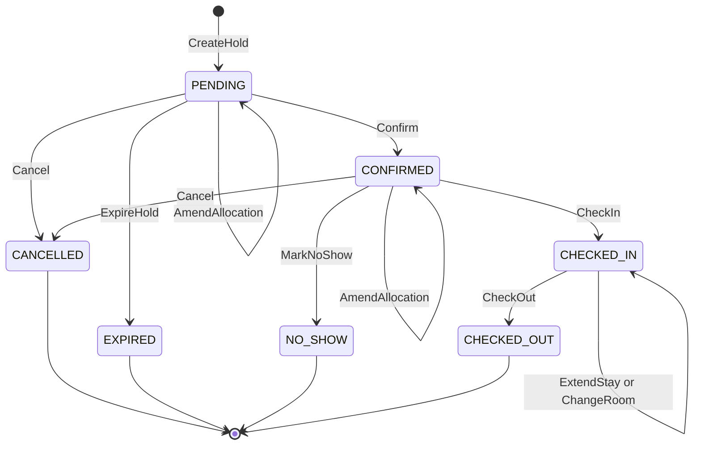
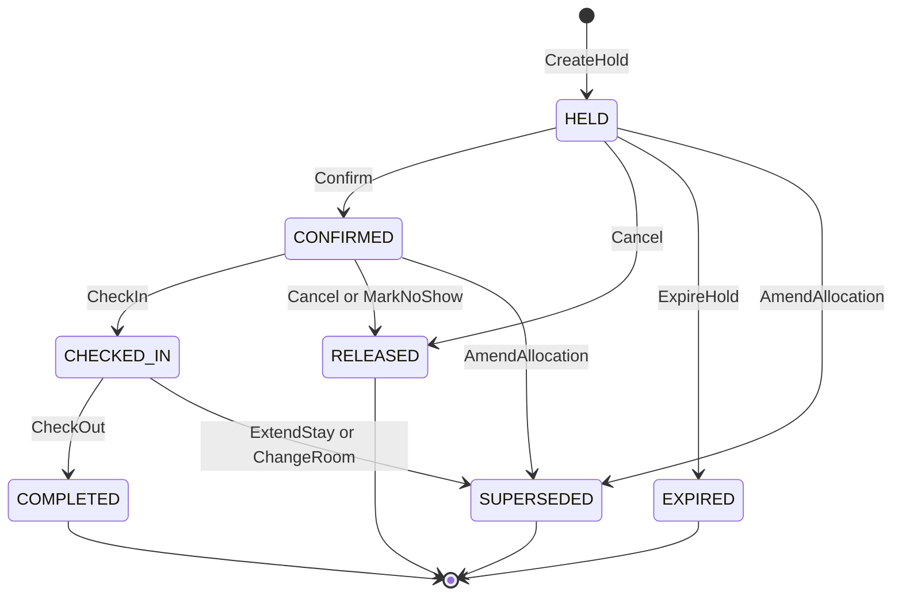
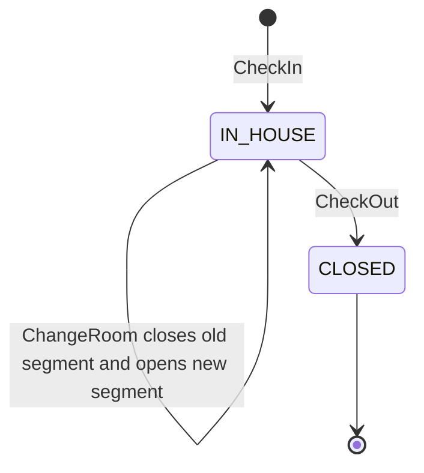
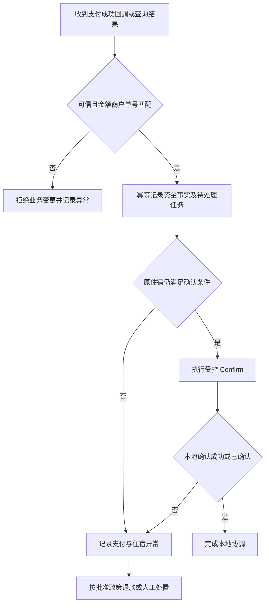

# PMS 订单、占用与入住状态机设计

> 版本：0.1；日期：2026-10-19（Asia/Shanghai）；任务：S0-02。
>
> 状态：设计草案已交付，业务分支和物理模型待冻结；不是已实现的 Java 枚举、数据库迁移或运行验证结果。
>
> 依据：[技术架构](../enterprise_hotel_pms_architecture.md) §4—§7、§9、§15；[需求范围](../requirements/scope.md)、[角色与用例](../requirements/roles-and-use-cases.md)、[业务决策台账](../requirements/decision-register.md)；配套：[状态机验收场景](./state-machine-scenarios.md)。

## 1. 设计边界与阅读方式

本设计给出命令、状态变化及原子副作用，作为 S0-04 数据建模和阶段 1/3 交易实现的输入。S0-01 尚有 OPEN 业务决定，因此本任务按已允许的方式推进候选设计，不把上游待确认事项伪装成已完成依赖。

沿用架构的确定约束：实体房不可重叠有效占用、多房多晚创建原子提交、半开日期、订单/占用/流水/Outbox 同事务、服务端授权、持久化幂等、外部调用不进入核心事务。

下列内容属于**本稿提出的实现候选**，正式启用前需要对应决策和 ADR：房间级履约子项、主单聚合状态、占用 `COMPLETED`/`SUPERSEDED` 终态、入住会话与房间分段、截止时间判定点。原架构列出的状态是示例，本稿对其作细化，不宣称原文已经批准这些新增枚举。

符号约定：`O` 为预订主单，`L` 为房间级履约子项，`A` 为实体占用记录，`S` 为入住会话，`G` 为实际房间入住分段。状态必须携带对象前缀理解，不能把 `L.CONFIRMED` 和 `A.CONFIRMED` 当作同一字段。

## 2. 对象职责与状态权威

| 对象 | 负责表达 | 状态权威与关系 | 不承担的职责 |
| --- | --- | --- | --- |
| O 预订主单 | 下单、归属、整体金额快照、子项集合和版本 | 一笔主单包含一个或多个 L；展示状态按 §5 从子项确定性汇总 | 不用主单单字段覆盖每间房不同的履约进度 |
| L 房间级履约子项 | 一间所购客房对应的预订及履约生命周期 | 一份独立房间需求；当前有效 A、S 与历史版本均关联 L | 房间数大于一的模糊行不能直接代表多间房的部分入住 |
| A 实体占用 | 某房、某日期区间、某占用版本是否仍参与互斥 | `HELD/CONFIRMED/CHECKED_IN` 是候选有效集合；所有有效 A 受排斥与维修互斥约束 | 不表达付款成功或客房清洁完成 |
| S 入住会话 | 一个 L 的实际履约过程 | 入住时创建；换房/续住不另建同一履约的第二个活动会话 | 不把换房作为离店后重新激活原终态 |
| G 房间入住分段 | S 在具体房间的实际入住时间段 | 活动分段只能一个；换房结束旧分段并创建新分段 | 不单独作为未来日期销售配额 |
| 支付/退款/渠道任务 | 外部动作和资金事实 | 独立的交易/任务状态，与 O/L 通过操作和事件关联 | 不用 `PAID`、`REFUNDING` 或 `OTA_TIMEOUT` 污染住宿生命周期 |
| 清洁/维修状态 | 房间运营条件及不可售区间 | 独立状态；入住和占用命令读取并验证 | 不通过“清洁完成”释放订单占用 |

L、S、G 是逻辑对象；是否一一映射数据库表、如何与现有 `reservation_room` 对应由 S0-04 决定。原 `reservation_room` 的实体占用权威职责保留，不能将它无声明地改成可有多个房间的销售行。

默认分析分支为“一单同店，多间房各有一个 L，预订时内部实体分配”，但 DEC-03/04/05/16 仍为 OPEN。如果业务选择真正未分房销售，需要追加配额状态机；不能将 `L.CONFIRMED` 无占用的例外直接塞进本文的实体分配分支。

## 3. 联合不变量

| 编号 | 必须成立的条件 | 保障与验收位置 |
| --- | --- | --- |
| INV-01 | O、L、A、S、G 与资源归属一致，任何读写有主体、租户、门店及对象权限 | 服务端授权、归属约束；S1-03、S0-04 |
| INV-02 | 同一实体房的有效 A 日期区间不得重叠；维修写入和预订写入执行同一互斥协议 | 排斥约束与维修资源锁协议；S1-05 |
| INV-03 | 创建一单所有 L 和 A、流水、审计、Outbox、幂等成功结果整体提交或回滚 | S1-06—S1-08 |
| INV-04 | 内部实体分配分支中，L.PENDING 的当前有效占用为 A.HELD，L.CONFIRMED 对应 A.CONFIRMED | 每次命令提交前后联合核对；多个历史终态 A 不计入当前集合 |
| INV-05 | L.CHECKED_IN 具有一个 IN_HOUSE 会话、一个 ACTIVE 分段和匹配的当前 CHECKED_IN 占用；同一实体房不能有两份未结束的实际入住分段 | 前台事务、活动关联唯一性、房间资源锁；S3-04/05 |
| INV-06 | L 的终态无当前有效 A；历史占用和入住记录保留，不能靠删除记录制造正确状态 | S1-09/10、S3-04；未来恢复须新建受控业务，不逆转终态 |
| INV-07 | 一个操作可以有多条房晚流水，但同一资源、业务效果、操作的流水不能重复；合法变更只有实际资源差异计入占用增减 | S1-06、S0-04 流水唯一键及口径 |
| INV-08 | 确认和入住保留已有占用，不再对相同资源二次扣减；清洁不直接生成预订释放 | S1-09、S3-04/06 |
| INV-09 | O 的聚合状态、计数及版本与 L 的本次变更在同一事务内一致；不得异步覆盖主单生命周期 | §5、S1-09、S3-05 |
| INV-10 | 换房/续住/改期失败时原有效占用、入住分段和金额快照保持原样；不能先提交释放再抢新房 | §8、S3-05 |
| INV-11 | 幂等重放原操作不再执行副作用；未知提交结果先核实，终态不因迟到消息复活 | §7、§9；S1-07、S2-02 |
| INV-12 | 支付/退款成功有可核实资金依据，且不能代替库存合法性；资金异常保留并生成可追踪处置 | §10、S4-04—S4-06 |
| INV-13 | 到期时间、前端倒计时、计划退房日期本身不能释放占用或终结实际入住 | §7.3、§8.3；S1-10、S3-04 |
| INV-14 | 仅合法命令改变状态，直接设置目标状态、忽略版本或人工绕过约束不是业务修复方式 | §6—§9、S2-04 |

若对账发现上述关系损坏，应标记异常并阻止相关破坏性写入，按受控修复处理，不能凭 UI 主单状态猜测并自动删除“多余”数据。

## 4. 三组生命周期

### 4.1 房间级履约 L

| 状态 | 含义 | 当前占用及入住要求 | 是否终态 |
| --- | --- | --- | --- |
| PENDING | 已完整创建，等待满足确认规则 | A.HELD；尚无入住会话 | 否 |
| CONFIRMED | 预订确认，等待入住 | A.CONFIRMED；尚无活动入住会话 | 否 |
| CHECKED_IN | 正在履约 | A.CHECKED_IN；S.IN_HOUSE 与 G.ACTIVE | 否 |
| CHECKED_OUT | 住宿履约已结束 | 无有效 A；S.CLOSED、G.CLOSED 或历史 TRANSFERRED | 是 |
| CANCELLED | 按批准规则取消 | 无有效 A；没有本次履约的活动会话 | 是 |
| EXPIRED | 未确认临时占用已完成超时处理 | 无有效 A；对应占用已 EXPIRED；不是仅看时间得出的状态 | 是；本稿新增候选 |
| NO_SHOW | 已确认但未按约入住，已完成批准的处置 | 无有效 A；无活动会话；未完成的退款/费用另行跟踪 | 是；仅适用最终处置完成的分支 |

每个箭头都必须满足 §6 条件，不代表无条件允许。入住前改期并不自动延长锁房 TTL；终态不得通过 Confirm、支付回调或 OTA 旧消息变回 CONFIRMED。走入式入住也必须组合合法的创建、确认、入住流程，不能绕开占用约束直接生成在住记录。

### 4.2 实体占用 A

| 状态 | 是否参与有效占用互斥 | 含义与下一步 |
| --- | --- | --- |
| HELD | 是，包括已经到时但尚未提交过期迁移的记录 | 可确认、主动释放、事务化过期或以受控替换换到新版本 |
| CONFIRMED | 是 | 可入住、按政策释放或受控替换 |
| CHECKED_IN | 是 | 正在履约，可完成离店或受控替换；不能由普通取消直接释放 |
| RELEASED | 否，终态 | 未入住取消/最终 No-show 等合法释放；原因独立记录 |
| EXPIRED | 否，终态 | HELD 的超时释放已完成 |
| COMPLETED | 否，终态，本稿新增候选 | 正常或批准的提前离店后完成占用，历史不可删除 |
| SUPERSEDED | 否，终态，本稿新增候选 | 被同一事务中的后继占用版本替换，须有后继关联及变更原因 |

图中 SUPERSEDED 只表示旧版本退役；对应命令还必须在同一事务创建后继有效 A，后继可以从 HELD、CONFIRMED 或 CHECKED_IN 的相应状态初始化，不能只退役旧记录就提交成功。这是替换版本建模建议，不是强制要求独立历史表，物理实现与 SQL 顺序在 S0-04 评审。

### 4.3 入住会话 S 与实际分段 G

| 对象/状态 | 含义 | 合法迁移 |
| --- | --- | --- |
| 尚无 S | 还未实际办理入住，不创建虚假“在住”记录 | CheckIn 创建 S.IN_HOUSE 与首个 G.ACTIVE |
| S.IN_HOUSE | 同一房间级履约正在进行 | ExtendStay/ChangeRoom 后仍在住；CheckOut → CLOSED |
| S.CLOSED | 本次实际入住完成 | 无常规复活路径；纠错走可审计更正/新业务 |
| G.ACTIVE | 当前实际使用的一间房 | ChangeRoom → TRANSFERRED；CheckOut → CLOSED |
| G.TRANSFERRED | 因换房结束的历史分段 | 终态，须指向后继分段 |
| G.CLOSED | 因离店结束的最后分段 | 终态 |

这里的实际开始/结束时间与销售住宿日期分别记录。换房只终结旧分段，不终结整个 S；同一 L 不能因为换房出现两个 IN_HOUSE 会话。多位同住人关联同一会话，不以人数创建多份实体房占用。

## 5. 多房订单主单聚合

### 5.1 首期功能分支

| 分支 | 候选能力 | 代价与限制 | 决策状态 |
| --- | --- | --- | --- |
| A 全单统一操作 | 创建、确认、取消、入住和离店均覆盖所有子项 | 状态简单，但同一订单客人分批到离店无法直接支持；不能将部分实际入住伪装成全部入住 | DEC-04 OPEN |
| B 原子预订 + 按房履约（建议比较方案） | 创建与初始确认原子；按 L 入住/离店/换房；部分取消和财务分摊需另行授权 | 需要聚合状态、计数和子项结算；首个子项入住不能代表所有子项入住 | DEC-04/09 OPEN |
| C 完整部分预订操作 | 再允许部分确认、取消、改期和独立住宿日期 | 需要额外过期策略、金额分摊、渠道兼容与验收；重新评估范围和工期 | DEC-03/04/06/09/11 OPEN |

以下聚合算法为候选 B/C 提供定义，不暗示已启用部分操作。命令入口先按批准能力检查组合是否可达；被禁用的组合即使能够计算汇总状态，也不能被正常创建。

### 5.2 确定性聚合规则

每个 O 的 L 集合非空，已创建的子项通过终态保留而不是从集合删除。记录七类状态计数，返回聚合状态时同时返回这些计数及取消/过期/No-show 等标记。若存储聚合字段，在改变 L 的同一事务内更新并递增 O.version。

按下表**由上到下命中首条**，不能采用“任意子项状态覆盖主单”的写法：

| 顺序 | 子项集合条件 | O 的候选聚合状态 | 展示约束 |
| --- | --- | --- | --- |
| 1 | 全部子项同为一种终态 | CHECKED_OUT / CANCELLED / EXPIRED / NO_SHOW 中对应值 | 保留数量及各资金/渠道进度，不推定资金已经结清 |
| 2 | 所有子项已终结，但具有不同终态 | CLOSED_MIXED | 明示“退房 x、取消 y、未入住 z”等，不把混合结局写成全部退房 |
| 3 | 存在 CHECKED_OUT 且仍有未终结子项 | PARTIALLY_CHECKED_OUT | 即使目前无人 IN_HOUSE，也表示有子项尚待后续履约 |
| 4 | 存在 CHECKED_IN，且另有 PENDING 或 CONFIRMED | PARTIALLY_CHECKED_IN | 不能用这个值决定任一具体房间可以释放 |
| 5 | 存在 CHECKED_IN，且其余子项均为非 CHECKED_OUT 的终态或 CHECKED_IN | CHECKED_IN | 若有取消/No-show，必须显示计数；不等于所有购买房间均入住 |
| 6 | 同时存在 PENDING 和 CONFIRMED，且无入住/离店子项 | PARTIALLY_CONFIRMED | 仅 C 分支可能正常出现；未开启部分确认时视为不一致异常 |
| 7 | 至少一个 CONFIRMED，子项仅由 CONFIRMED 及 CANCELLED/EXPIRED/NO_SHOW 构成 | CONFIRMED | 终态子项计数仍可见，不复活已取消部分 |
| 8 | 至少一个 PENDING，子项仅由 PENDING 及 CANCELLED/EXPIRED/NO_SHOW 构成 | PENDING | 仅剩待确认子项参与相应命令；允许的部分终结规则待定 |

空集合、未知子项状态或违反已批准分支的组合标记为一致性异常，不生成新的生命周期状态掩盖错误。`PARTIALLY_*` 和 `CLOSED_MIXED` 为本稿新增候选，不能未经审查直接替换原状态枚举。

| 示例（均是候选分析输入） | 汇总结果 | 说明 |
| --- | --- | --- |
| 两间 CONFIRMED | CONFIRMED | 两间均待入住 |
| 一间 CHECKED_IN，一间 CONFIRMED | PARTIALLY_CHECKED_IN | 已入住一间，另一间保持确认占用 |
| 一间 CHECKED_OUT，一间 CHECKED_IN | PARTIALLY_CHECKED_OUT | 仅对离店子项终结占用 |
| 一间 CHECKED_OUT，一间 CONFIRMED | PARTIALLY_CHECKED_OUT | 不能因为无人当前在住就把整单关闭 |
| 一间 CHECKED_IN，一间 CANCELLED | CHECKED_IN + cancelled_count=1 | 显示混合情况，主单不可再执行全单普通取消 |
| 一间 CHECKED_OUT，一间 CANCELLED | CLOSED_MIXED | 所有子项终结，结果不相同 |

## 6. 命令与合法迁移矩阵

所有修改命令均先授权、核对幂等语义，再在事务内锁定业务对象和资源、检查当前状态与版本。表中的事件是候选内部事件名称，必须携带操作 ID、主单/子项标识、聚合版本、事件版本及租户归属，不携带非必要敏感信息。

| 编号 / 命令 | 原状态与前置条件 | 事务内新状态与副作用 | 库存/账务影响 | 事件 / 非法路径 |
| --- | --- | --- | --- | --- |
| CMD-01 CreateHold | 对应作用域无已完成同键交易；完整区间可用；启用的报价/政策有效 | 原子建立 O、所有 L.PENDING、A.HELD、截止时间、流水、审计、Outbox、结果 | 仅新增合法占用房晚；锁定报价快照；不执行外部收款 | ReservationHeld；任一资源失败全部回滚，同键异内容冲突 |
| CMD-02 Confirm | L.PENDING；A.HELD；确认依据、版本、截止条件有效；范围满足批准的全单/部分策略 | 目标 L → CONFIRMED，A → CONFIRMED，汇总 O | 已占用资源无额外扣减；保存确认依据，支付状态独立 | ReservationConfirmed；已过期/取消拒绝，旧确认不复活 |
| CMD-03 Cancel | 目标 L 为 PENDING 或 CONFIRMED，取消权限和政策允许；若全单命令则所有目标均满足 | 目标 L → CANCELLED，A → RELEASED；O 汇总；产生必要退款/渠道任务 | 仅释放目标当前占用一次；取消费/退款按批准政策形成独立账项/任务 | ReservationCancelled；CHECKED_IN/终态不可经普通取消强制迁移 |
| CMD-04 ExpireHold | L.PENDING、A.HELD，锁后复核到期，领取有效且未确认 | 目标 L → EXPIRED，A → EXPIRED；同事务流水/事件/O 汇总 | 释放一次；支付未知或晚到须另行核实，不能撤销外部资金事实 | ReservationExpired；已确认则跳过；全单锁房策略下整组处理 |
| CMD-05 CheckIn | L.CONFIRMED、A.CONFIRMED；入住日期/证件/清洁/资金条件满足；无活动会话及他人活动分段 | L → CHECKED_IN，A → CHECKED_IN；建立 S.IN_HOUSE、G.ACTIVE；O 汇总 | 已有资源不重复扣减；入住相关账项仅按批准政策生成 | GuestCheckedIn；重复操作回放原结果，维修或实际仍被占用则拒绝 |
| CMD-06 ExtendStay | L.CHECKED_IN、S.IN_HOUSE；新增日期和报价/资金条件有效 | 旧 A → SUPERSEDED；建立覆盖延长后计划区间的 A.CHECKED_IN；S/G 仍活动；更新版本/快照 | 仅新增加的房晚产生占用增量；差额账项唯一；原消费历史不重记 | StayExtended；新增区间冲突时原数据完整保留 |
| CMD-07 ChangeRoom | L.CHECKED_IN；目标同店且符合容量、清洁和可用规则；日级切换边界已定义 | 旧 A → SUPERSEDED，新 A.CHECKED_IN；旧 G → TRANSFERRED，新 G.ACTIVE；S 保持 IN_HOUSE | 只对生效区间的旧/新资源差异释放和占用；旧房置适当待清洁状态；差额受控 | RoomChanged；目标冲突全部回滚，不先交房后抢房 |
| CMD-08 CheckOut | L.CHECKED_IN、S.IN_HOUSE；结算或批准挂账条件满足；退房时间政策有效 | L → CHECKED_OUT，A → COMPLETED，S → CLOSED，当前 G → CLOSED；O 汇总，房务任务 | 历史消费不抹除；仅按实际生效边界释放尚未履约资源；余额/退款另记 | GuestCheckedOut；未满足结算拒绝或走明示例外，不直接篡改支付状态 |
| CMD-09 MarkNoShow | L.CONFIRMED；从未入住；业务截止/时区/渠道核实和授权条件满足 | 最终处置时 L → NO_SHOW，A → RELEASED；O 汇总；费用/渠道任务留痕 | 未来占用按政策释放一次；罚金不能凭状态名自动产生 | ReservationNoShow；与 CheckIn 互斥，规则未定或渠道未核实不执行终结 |
| CMD-10 AmendAllocation | L.PENDING 或 CONFIRMED；允许入住前改期/排房/房型；新报价、TTL 和渠道条件通过 | 旧 A → SUPERSEDED；新 A 保持 HELD 或 CONFIRMED；L 状态不变，O 版本递增 | 仅资源集合差值计增减，保留旧报价/占用版本；不隐式延长 TTL | ReservationAmended；日期不合法、目标冲突或未启用部分变更则整次拒绝 |
| CMD-11 ResolvePaymentSuccess | 可信且金额/商户/单号匹配的支付成功；资金事件幂等 | 原子记录本地资金事实及处理任务；条件仍满足时通过 CMD-02 确认，否则保留异常并补偿 | 不凭付款创建越过约束的占用；退款/重订必须独立批准 | PaymentResolved 或 PaymentExceptionRecorded；外部事实不能因本地无房被丢弃 |
| CMD-12 ApplyChannelNotification | 渠道授权有效；订单/请求作用域清楚；通知去重、新旧关系可判定或已查询核实 | 转换为 CMD-01/02/03/10 等受控命令；本地映射与相应效果原子一致 | 复用核心库存逻辑；不从外部状态字段直接覆写 L/A | 复用对应领域事件；旧/重复通知无新增效果，未知顺序进入核实任务 |
| CMD-13 StartRoomBlock | 房间归属正确，区间有效，具有维修权限；统一互斥锁下无冲突占用/实际入住 | 创建生效维修区间及审计/事件；L/A 不被静默取消 | 不可售变动按房间区间集合计算，不能与占用重复扣减 | RoomBlockStarted；已入住紧急维修转协调流程 |
| CMD-14 EndRoomBlock | 存在生效维修且解除权限/状态合法 | 维修终结及审计/事件；保留历史，不改 L/A | 仅解除维修带来的不可售限制；仍有占用/其他限制则不能计为可售 | RoomBlockEnded；重复解除无重复增量 |
| CMD-15 CompleteHousekeeping | 房务任务/版本与权限有效，所需检查条件满足 | 清洁状态转换，L/A/S/G 不随之变化 | 无预订释放；维修未解除不能被覆盖 | HousekeepingCompleted；无权或旧版本拒绝 |
| CMD-16 QueryOrReplayOperation | 当前仍有原对象/请求权限，提供同作用域原操作信息 | 只读原结果，或按受控调度重放原幂等命令；不新造业务意图 | 已提交效果不重复；当前状态可另查，不能将历史响应冒充当前状态 | 结果查询无新业务事件；重放动作本身记录审计，无法判定保持待核实 |

CMD-13—CMD-15 是协作命令，用于说明三组主状态机与运营状态的关系，不在本稿展开完整维修/清洁枚举。CMD-11/12 的支付及渠道独立状态机由 S0-06/07 结合真实协议补齐。

### 6.1 禁止的快捷迁移

- `L.CHECKED_IN → CANCELLED/EXPIRED/NO_SHOW`：须通过实际离店、账务与必要补偿处理，不能用普通取消释放仍住人的房间。
- `L.CANCELLED/EXPIRED/NO_SHOW/CHECKED_OUT → CONFIRMED/CHECKED_IN`：终态不复活，重新预订需新标识、重新占用及历史关联。
- `A.RELEASED/EXPIRED/COMPLETED/SUPERSEDED → 任意有效状态`：保留旧记录，合法新业务或版本必须另建并重新竞争资源。
- `S.CLOSED → IN_HOUSE`、`G.TRANSFERRED/CLOSED → ACTIVE`：不存在常规恢复箭头，错误办理的修正属于单独受控流程。
- 任意状态通过“管理员强制”跳过租户、占用、退款额度或归属条件：禁止。授权只能允许业务例外，不能取消数据不变量。

## 7. 事务、幂等与截止时间

### 7.1 一次状态命令的执行顺序

1. 验证当前身份、权限及对象范围，规范化请求及摘要；身份撤权后不能通过幂等缓存绕过授权。
2. 进入数据库短事务，按明确作用域锁定/建立幂等记录；已完成同键同摘要先返回原结果，不能先用旧 expected_version 把合法重试误判为新冲突。
3. 对新效果按固定顺序锁定 O/L 及涉及的实体房资源，重新读取状态、版本、日期、运营条件和必要资金依据。跨表归属、外键与锁策略在 S0-04 固化。
4. 比较期望版本；任何影响子项汇总、资源或金额的并发命令都不能无条件覆盖旧版本。
5. 执行合法迁移，写全部必要占用/入住关联、流水、账项、关键审计及 Outbox；重新计算 O 的状态和计数，递增版本。
6. 保存与本次提交一致的幂等结果；提交完成后才对调用方报告业务成功。
7. 数据库事务外发布事件或调用支付/OTA；调用未知结果交由可靠任务查询确认或安全补偿。

普通冲突或写入失败回滚本次全部业务效果。若失败导致幂等记录一起回滚，后续重试重新核验，不能据此推导曾经成功；是否单独保存确定性拒绝结果及保留期由 S0-04 的幂等协议决定。独立安全拒绝日志不包含不必要敏感信息，也不冒充成功交易审计。

### 7.2 锁顺序与重试规则

建议全系统采用同一层级：幂等/操作记录 → 按 ID 排序的 O/L → 按租户、门店、房间 ID 排序的资源锁 → 占用/入住/资金等必要关联。所有命令和任务，包括维修、支付联动及多房换房，都遵守顺序；无订单的维修只取资源锁且不再反向获取订单锁。

这是锁协议候选，不是已验证 SQL。S0-04 必须列出每条写路径及新增资源再次排序策略；事务中途发现需要更小排序的资源时回滚重试，不能临时倒序补锁。对可安全重试的死锁/序列化失败采用有界退避，同一幂等意图不换 key；提交结果未知时先查原结果，不执行新的非幂等动作。

### 7.3 到期临界点候选规则

- 创建锁房时保存明确 `expires_at`，取可信服务端时间基准，客户端倒计时只作展示。
- 建议 Confirm 取得必需锁后采样判定时间 `decision_time`，要求 `decision_time < expires_at`；ExpireHold 要求 `decision_time >= expires_at` 且状态仍可过期。
- 在截止前发起但锁等待跨过截止的请求，按锁后时间判定，不按客户端发送时间获得优先权。
- 若 Confirm 在截止前完成合法检查并持有锁，短事务在截止后提交的语义需要明确：本候选以锁后检查点为准；“必须截止前提交”的严格方案属于不同规则，不能混用两种时点。
- 过期扫描可略晚，但在清理事务完成之前 A.HELD 仍参与互斥；可售查询不能仅凭时钟忽略它。
- 全单锁房候选采用统一截止点，过期任务领取 O 后整组处理，不能按房间分批提交造成一单部分过期。若批准部分确认/不同 TTL，须先冻结剩余子项过期和聚合规则。

具体时长、是否允许延期及付款处理中如何处理保持 DEC-06/08 OPEN，不填入任意默认分钟数。数据库时间采样及隔离行为在实际实现时验证。

## 8. 占用历史、改期、换房与离店

### 8.1 历史与当前事实分开

`stay_range` 表达销售日期区间，入住 G 保存实际时刻。退役 A 的原区间、状态变更原因和后继关系应可追溯；完成退房不能删除原住宿证据。允许修改当前记录加历史版本表或创建后继记录，两者选一并在 S0-04 固化；本文使用后继记录表述以避免覆盖历史。

候选 SUPERSEDED 流程在同一事务中：锁定旧/新资源 → 校验目标 → 退役旧版本 → 建后继有效版本及当前指针 → 写差异流水与关联事件 → 提交。目标约束失败使退役也回滚。任何提交瞬间都不允许 L 保持有效而没有相应占用。

占用生命周期改变不等于每条记录都产生一次“库存 +1/-1”。建议流水基于命令前后受影响资源集合及原因计算；HELD→CONFIRMED、CONFIRMED→CHECKED_IN、相同资源的版本替换均不重复扣减。S0-04 要进一步定义房晚粒度、释放生效日、唯一键以及与历史消费/收入的独立核对口径。

终态 A 不再参与有效占用排斥，因此普通新预订/改期命令还必须限制回溯日期；不能因为历史记录已终结就允许重新销售过去住宿日期。历史补录或数据迁移应有单独模型和校验流程，不使用普通 CreateHold 伪造过去的有效预订。已在住订单续住时携带原历史区间是同一履约的版本替换，不是新的回溯售卖。

### 8.2 续住与换房

| 操作 | 保留什么 | 原子改变什么 | 必须失败而回滚的情况 |
| --- | --- | --- | --- |
| 续住 | 已消费住宿、S、活动 G、旧报价及占用历史 | 后继 A 的延长区间、更新后的计划退房、增量报价/账项、版本和事件 | 任一新增房晚冲突、缺价、权限不足或版本变化 |
| 入住前改期/排房 | 订单身份、旧计划与报价版本 | 完整新资源集合、当前关联和差额；L 仍 PENDING/CONFIRMED | 原子目标资源无法全部取得，或会隐式修改未批准 TTL |
| 已入住换房 | S 连续性、旧 G 实际入住历史、旧房消费 | 旧 G 结束、新 G 活动、新 A、旧房房务状态和差额 | 目标房有其他活动入住、维修/清洁不合格、目标日期冲突 |

自动拆段换房不等于客人已同意换房。若查询发现不同夜晚只能住不同房间，未经 DEC-16 启用的销售模式不能把这作为“一间连续可售房”返回。

### 8.3 日级日期不能代替实际占房控制

前客计划今日离店、后客计划今日入住的住宿日期可合法相邻，但前客若尚未实际离店，后客不得办理入住。CheckIn 除日期约束外还必须在同一资源互斥协议下检查活动 G、清洁及维修。

检测到超期实际入住时保留真实会话，产生运营冲突并阻止该房冲突的再次入住；当天新可售/排房不得忽略实际占用。对已有后续确认订单进入显式协调流程，不能静默取消、挪房或把前客自动 CheckOut。

当天换房、提前退房后当日再入住涉及库存切换日、收费与清洁边界，必须由 DEC-06/16 和 S0-05 明确：日级销售范围不能精确表达所有小时级物理使用历史。未定规则不得通过写空区间、回填虚假历史日期或扩大有效状态豁免来解决。

### 8.4 终态后的更正

普通接口不提供任意 `setStatus`。误取消、误离店等问题由受控更正流程评估：保留原交易，必要时新建关联订单/占用或调整账项，并重新执行权限、资源和资金检查。是否允许重开入住属于新增业务决定，当前未设计为通用“撤销终态”按钮。

## 9. 并发与异常裁决

“先提交者胜”不足以描述全部规则：每个命令必须在锁后检查最新状态及自身政策；失败方返回状态冲突、已处理结果或进入明确核实流程。库存约束不能让步于请求到达顺序。

| 编号 | 并发/异常 | 合法结果与失败方行为 | 不允许的结果 |
| --- | --- | --- | --- |
| RACE-01 | 同房同日期两个 CreateHold | 一方占用成功，另一方约束冲突并全量回滚 | 两份有效占用或失败单残留部分房间 |
| RACE-02 | 同键 CreateHold 重试 | 同摘要返回原结果；异摘要拒绝 | 生成另一订单或覆盖原请求内容 |
| RACE-03 | Confirm 与 Cancel | 在 PENDING/CONFIRMED 合法政策下串行判定；确认先成功后取消仍可能合法，故两命令可能都成功但最终 CANCELLED | 把两个成功响应误判为两份占用；取消后旧确认复活 |
| RACE-04 | Confirm 与 ExpireHold | Confirm 锁后未到期且先完成则过期任务跳过；已到期/已过期则确认拒绝 | 仅靠任务尚未运行允许已到期锁房无条件确认 |
| RACE-05 | 两个过期或取消任务 | 同操作回放，另一合法不同操作核验当前终态后无新增效果或返回冲突 | 重复释放或重复取消费用 |
| RACE-06 | CheckIn 与 Cancel/MarkNoShow | CheckIn 先合法完成后普通取消/No-show 拒绝；终结先完成则入住拒绝 | 同一 L 同时入住和释放 |
| RACE-07 | CheckOut 与 ExtendStay/ChangeRoom | 锁后核对版本；后续命令按新状态重新决定；已离店不能续住/换房 | 释放原房成功而新房失败，或关闭后的 S 被复活 |
| RACE-08 | 两单同时换入同一目标房 | 统一锁序及排斥约束裁决，一方失败保留原房 | 两个 ACTIVE 分段指向同一实际房间 |
| RACE-09 | StartRoomBlock 与预订/入住 | 在共享资源锁下检查双方最新状态，一方拒绝或转运营协调 | 两张表各自校验通过但实际冲突 |
| RACE-10 | PaymentSuccess 与过期/取消 | 保留真实支付事实；住宿能否确认重新检查，无法确认则生成独立处置 | 因订单终态丢弃资金事实，或为成功支付抢回他人房间 |
| RACE-11 | OTA 取消后旧确认/无版本通知 | 可靠版本判旧；无可靠顺序则查询渠道并核对本地命令，不直接改状态 | 依接收时间或外部 status 字段复活订单 |
| RACE-12 | 提交完成后响应丢失/主库连接断开 | 按原幂等与业务记录核实；仍未知则保持处理中/待核实并限制重试 | 客户端未收到成功就假定无交易，另起新操作 |
| RACE-13 | 多子项同时入住/离店 | 串行更新同一 O 或等价已验证并发协议，聚合计数与版本一致 | 只更新最后一个写者的主单摘要，丢掉另一子项进度 |
| RACE-14 | 计划退房日已到但实际未离店 | 实际活动分段持续，后续入住阻止并告警；已有预订进入协调 | 定时任务自动结束会话，把仍住人的房间交给下一客人 |

注意 RACE-03：禁止要求“确认与取消永远只有一个 API 返回成功”。若确认后合法取消，两次命令都成功是正常顺序历史；正确判据是合法迁移、最终状态一致及只释放一次，而不是机械统计成功响应数量。

## 10. 支付与渠道的协调边界

### 10.1 支付成功后的判定

记录资金事实与执行 Confirm 可以在一个本地短事务中协调，也可以先可靠保存事实和任务后分步执行，方案由 S0-07 固化；无论哪种，库存冲突不能导致已核实支付永久丢失。重复处理已确认/已入住且支付归属匹配的订单时不能再次确认或扣库存；退款成功也不反向复活订单。

建议对终态订单晚到支付优先进入退款/人工处置候选分支。若业务允许重新购房，应新建关联预订并重新竞争资源、核价和授权，不能将原 EXPIRED 直接改回 CONFIRMED。金额分摊、退款额度及最终资金状态由 S0-07 定义。

### 10.2 OTA 取消意图与本地完成分开

需要远端批准的取消先记录独立取消任务/意图及状态，L 保持原有效状态和占用；到达协议认可的本地执行点才调用 Cancel。若协议规定通知即生效，可直接执行对应合法迁移，再可靠反馈结果。

取消挂起是否暂时禁止入住/修改，必须在 DEC-11 中按渠道定义，并作为命令条件显式检查。不能把“取消请求已接收”展示为“已取消并已退款”，也不能在尚未确定取消生效时释放本地房间。

收到取消先于创建时，保存可核实的外部状态/事件记录，按协议查询；后续创建通知不能绕过已知取消依据直接建立确认占用。这里的外部待核实状态不需要变成 L 的新枚举。

## 11. 审计、事件与操作结果

### 11.1 状态迁移审计字段

至少记录：事件/操作 ID、幂等关联、主体类型及标识、租户/门店、O/L/A/S/G 的相关 ID、原状态和新状态、原版本和新版本、规则/报价版本、实际业务时间、记录时间、原因及可信外部引用。批量命令能追溯每个目标子项，不把住客证件或支付秘密复制到事件载荷。

每次有业务变化的命令产生可追溯领域事件；一次命令可按需要产生多个事件，消费者使用 event_id 去重。一次主单事务将 O.version 增加一次时，其多个事件可共享 aggregate_version，但必须有各自 event_id 与明确用途；消费者不能假定“一个版本只会有一个事件”而误丢同版本的其他必要事件。事件序号/快照策略在 S0-09 冻结。

### 11.2 API 结果类别

| 结果 | 表达含义 | 客户端/任务处理 |
| --- | --- | --- |
| APPLIED | 当前命令效果已提交 | 使用返回的版本和业务引用更新界面 |
| REPLAYED | 同一幂等操作曾成功，返回原结果 | 不重复执行；如需实时状态另外查询 |
| CONFLICT | 资源、状态、版本或同键异内容冲突 | 显示具体可公开原因并刷新；改变意图必须显式产生新操作 |
| REJECTED | 无权限、参数/政策不合法或模式未启用 | 修正原因；不盲目重试 |
| PENDING_VERIFICATION | 本地提交/外部调用结果尚不能确定 | 保留原标识并查询，不误报成功或失败 |
| NO_CHANGE | 已不满足后台条件，或已达同一效果而无新迁移 | 根据命令合同记录跳过/已有结果，不生成重复流水或领域事件 |

这些是候选语义，不是已冻结 HTTP 状态码。不同 key 指向同一已完成效果是否返回 NO_CHANGE 或 CONFLICT 应在每个命令契约中固定；同一 key 同摘要重试优先返回原结果。结果返回前仍需当前权限检查。

## 12. 尚待冻结的规则与后续交付

| 决策/任务 | 需要冻结的内容 | 未冻结前的边界 |
| --- | --- | --- |
| DEC-03/04，S0-02 | 单/多房型、独立日期、部分确认/取消/入住/离店；O 聚合枚举 | 保留 A/B/C 分支，不能将任何一个写成已批准业务行为 |
| DEC-05，S0-04/05 | 实体即时分配或真正未分房配额 | 本文实体分配不变量不能直接用于无 A 的确认订单 |
| DEC-06/07/16，S0-05 | 到期判定点、No-show 截止、早晚到离店、换房切换日、日级/小时级范围 | 不生成收费时间默认值；不创建非法空区间解决时间冲突 |
| DEC-08/09，S0-07 | 确认付款条件、挂账、押金、取消费、部分退款与差额 | 仅定义协调接口，不声称资金模型已完成 |
| DEC-11，S0-06 | OTA 确认/取消语义、外部版本与订单 ID 作用域 | 外部报文只能经适配和核实后触发领域命令 |
| S0-04 | L/A/S/G 的物理模型、活动关联唯一性、历史版本、锁顺序、流水口径 | 本文不是可直接执行的 DDL，不复制概念性结构直接上线 |
| S0-09 | 事件 schema、同版本多事件、命令错误码与 API 契约 | 命名保留为候选，不产生破坏兼容的假契约 |

S0-02 当前为 **VERIFYING（设计文档与场景已交付，关键业务分支待冻结）**。本文提供“旧状态→命令→新状态→库存/账务影响”的设计输入，后续需先收敛关键决策，再由真实 PostgreSQL 测试验证事务、约束和竞态。

下一项可独立推进的计划工作是 **S0-03 技术栈收敛与兼容性验证**；S0-04 可以准备数据模型候选，但不能越过本稿未决状态语义直接固化最终迁移。
