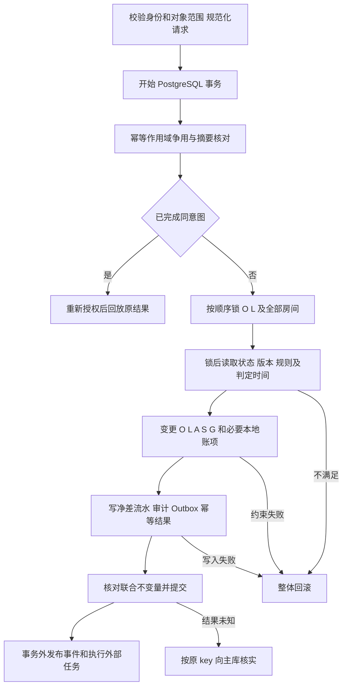
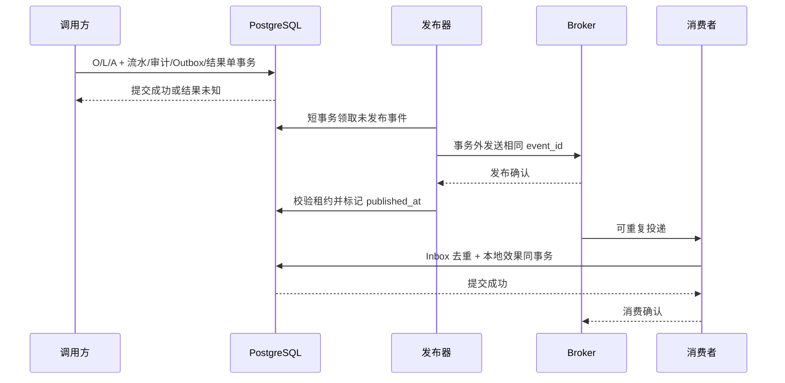

# PMS 事务边界、锁顺序与恢复协议

> 版本：0.1；2026-10-19；S0-04 候选。输入：[模型](./data-model.md)、[字典](./data-dictionary.md)、[状态机](./state-machines.md)。尚未执行锁竞争或故障测试。

## 1. 核心短事务

核心候选隔离级别是 READ COMMITTED，配合显式锁、版本检查与统一排斥约束。所有关键验证在获取相应锁后重新读取，不使用锁前查询的空闲结论。多条 SQL 的快照可能不同；需要一致资源集合的读必须用持有的资源锁或明确快照。更换隔离级别不替代重试、幂等或约束。[事务隔离](https://www.postgresql.org/docs/17/transaction-iso.html)。

## 2. 全局锁层级

| 层级 | 对象 / 顺序 | 规则 |
| --- | --- | --- |
| L0 | 已验证的租户、门店与命令主体上下文 | 授权不可由请求 tenant_id 推导；管理停用规则须在写入门禁复核 |
| L1 | 幂等 key / operation | 先争用同一意图；等待有界，等待超时不能返回业务成功 |
| L2 | O 按 `(tenant_id,hotel_id,id)` 升序；其 L 按 id 升序 | 所有改变 O 汇总的路径先锁 O；新建 O 对本事务私有，编号生成不得反向获取共享锁 |
| L3 | physical_room 按 `(tenant_id,hotel_id,id)` 升序 | 一次命令涉及旧、新全部房间；替换、封房、清洁、投影均按相同顺序 |
| L4 | A、S、G、批准的本地账项等按固定表序和主键序 | 在 O/房间锁后获取；不从这些行反向获取另一 O 或更小房间 |
| L5 | 追加流水、审计、Outbox，更新 O/房间版本，幂等结果 | 新增行引用不应引入跨聚合反向锁；正式 SQL 按实际 FK 锁行为做双会话测试 |

锁顺序是应用约定，不是数据库自动保证；FK、索引、DDL 及第三方写入仍可能引发死锁。候选范围内保持事务短小、超时与整事务有界重试，S1 必须验证实际 SQL 的隐式锁。PostgreSQL 行锁会保持到事务结束，冲突等待及死锁仍需显式处理。[锁文档](https://www.postgresql.org/docs/17/explicit-locking.html)。

- 锁前先选候选房间，获取全部锁后复核。发现需要其他房间则**回滚整次事务后重新选房排序**；不能持有旧锁临时补抓小 ID 房间。
- 多房换房在同一 O 内遵守以上规则；跨订单换房/交换当前不开放。若批准跨 O 操作，必须先确定全部 O 并排序锁定，再锁所有房间。
- 无订单维修/清洁只走 L1→L3→L4→L5。发现有冲突 O 时返回冲突/创建协调任务，释放锁后另发合法命令；不在房间锁里反向锁 O。
- 到期扫描先只读候选 O，再按上述顺序锁 O 和其全部资源；不能先对 A 使用 FOR UPDATE SKIP LOCKED 后再锁 O。
- 任务/Outbox 领取使用独立短事务，提交租约后再调用业务事务；执行期间不得保持任务行锁跨入核心事务。旧执行者写回须验证租约 token，业务仍靠幂等防重。
- 投影重建只锁房间，不反向锁订单。观察到有效 A 变动而未提交时，房间锁将串行化；重建事件通知在提交后处理。

## 3. 写路径矩阵

| 路径 | 锁定范围 | 同事务效果 | 外部动作 / 注意事项 |
| --- | --- | --- | --- |
| CMD-01 CreateHold | key；新 O/L；全部选定房间 | O/L/A、净差、审计、O/房间版本、Outbox、结果 | 无支付/OTA HTTP；多房任一失败全回滚 |
| CMD-02 Confirm | key→O/目标 L→全部当前房间→A | L/A、确认依据、O 聚合/版本、房间刷新版本、审计/事件/结果 | 无二次库存扣减；锁后检查 expires_at |
| CMD-03/04/09 Cancel/Expire/NoShow | 同上，目标范围遵守批准的部分/整单策略 | 终态、净差、批准账项/任务、O 汇总及共同记录 | 退款、渠道通知在事务外；No-show 不自动收费 |
| CMD-05 CheckIn | key→O/L→房间→A/S/G | L/A、S/G、O 汇总、实际使用/房务依据、共同记录 | G 活动唯一、清洁、资金条件均检查；相邻日期仍可能拒绝 |
| CMD-06/07/10 续住/换房/改期 | key→O/L→旧新全部房间→旧 A/S/G | 退役全部旧 A、建立后继、必要 G 替换、报价引用/净差/O 版本/共同记录 | 目标冲突回滚到原 A/G；无先释放后抢房 |
| CMD-08 CheckOut | key→O/L→当前房间→A/S/G/本地账项 | L/A/S/G 终结、有效窗口释放、清洁任务、共同记录 | 挂账/结算条件由 S0-07；实际支付到账不是本事务承诺 |
| CMD-13/14 封房/解封 | key→相关房间→B | BLOCKED/UNBLOCKED、净差、房间版本、审计/事件/结果 | 与预订共享排斥；拒绝冲突并保留原订单 |
| CMD-15 清洁 | key→房间→房务数据 | 清洁版本、房间刷新事件、审计/结果 | 不改 A、不释放库存、不结束 G |
| CMD-11 资金事实 | 资金模块自身的确定去重顺序 | 可信事实+可靠协调任务 | 独立事务结束后调用 Confirm；不可持资金锁反向进入核心 O 锁 |
| CMD-12 渠道通知 | 适配器持久化通知后进入核心标准锁序 | 映射与核心效果按已定契约原子关联 | 若前置收件分事务，必须有可靠任务；只收件不算已应用 |
| CMD-16 查询/回放 | 查询按当前权限；新执行按原命令顺序 | 已完成查询无新增业务效果 | 未知结果查主库；不以滞后副本的“无记录”判失败 |

共同记录指操作摘要、审计、Outbox、正确的主单/房间版本和结果；不是所有命令都必须写资源增减流水。纯查询不增加版本；无业务变化的 NO_CHANGE 可以保存操作结果与操作审计，但不捏造领域变化事件。

## 4. 时间与状态检查

事务开始时间不能直接当作等待后的判定时间。候选实现是在拿到所需锁后采样数据库 `clock_timestamp()` 并保存 `decision_time`，用于 Confirm `< expires_at` / Expire `>= expires_at` 的相反条件；具体政策仍由 DEC-06/S0-05 冻结。应用和数据库时间偏差、等待跨截止、确认检查后跨截止提交都需要专门场景。[PostgreSQL 日期时间函数](https://www.postgresql.org/docs/17/functions-datetime.html)。

与 `expires_at` 无关的业务操作也要核对批准的酒店时区、营业日及库存生效日，不用服务器零点替代。原响应回放发生在新 expected_version 检查之前，但必须在当前授权之后。

## 5. 发布、消费与原子性边界

发布成功而 published_at 写回失败允许重发；消费者提交成功但确认丢失允许再次收到；同一个 aggregate_version 下的不同 event_id/ordinal 都必须按自身语义处理。具体 schema、版本缺口和同版本事件策略在 S0-09/S2 冻结，不能只以“版本不大于已见值”丢弃所有事件。

## 6. 失败与恢复

| 失败点 | 可观察结果 | 恢复方式 |
| --- | --- | --- |
| 约束冲突 / 已知回滚 | 无本次已提交效果 | 返回领域冲突；若另选房间，保持同一意图并重新授权/核价 |
| 死锁 / 序列化失败 | 整个事务失败 | 有界退避重试完整命令，同 key 同摘要；超过预算返回可重试结果 |
| 锁超时 | 不能据此认定对方操作完成 | 回滚本事务，按幂等结果查询或返回处理中；不硬编码无限重试 |
| commit 响应丢失 / 连接断开 | 是否提交未知 | 使用原 key 向主库查询；无记录时仍需排除未决事务/主库切换，重试由唯一键串行裁决 |
| 关键审计/Outbox 插入失败 | 本次业务不得单独成功 | 整体回滚；独立安全日志不冒充业务审计 |
| 资金成功但 Confirm 无法成立 | 住宿保持合法终态/冲突状态 | 资金事实和任务已持久化，按政策退款或人工处理 |
| 投影丢失/滞后 | 展示可陈旧，不改变已成交事实 | 按房间权威集合重建；成交始终走核心约束 |

恢复不能靠直接改状态或删除冲突记录。受控修复需要原事实、修复操作 ID、原因、授权、前后差异及相同约束；超出已定义命令范围的修复留人工审查。超时和重试次数由容量实测后配置，本稿不编造数值。
