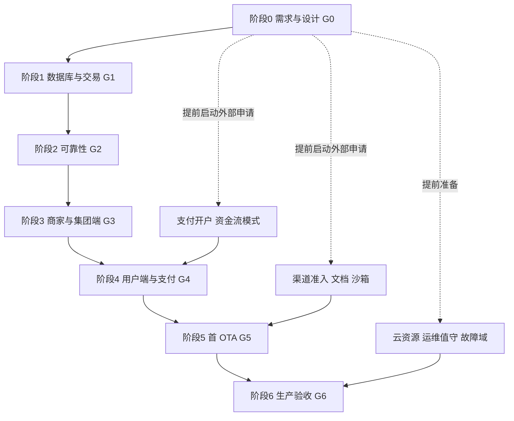

# 企业级酒店 PMS 开发任务规划

> 版本：1.4
>
> 编制日期：2026-10-19（Asia/Shanghai）
>
> 状态：可用于拆分研发任务；业务规则、技术选型及外部接入条件仍需按任务确认。
>
> 依据：[企业级酒店 PMS 技术架构设计文档](./enterprise_hotel_pms_architecture.md)，版本 1.0。
>
> 适用方式：单人主导、AI 辅助开发，先完成交易正确性，再逐步开放多端与渠道。
>
> 本文是实施规划，所有任务初始状态均为 `TODO`；最新执行进度见 §1.3。所列能力、目录、测试报告及服务指标均不代表已经实现。
>
> 执行层文档见 [docs/development/](./development/README.md)：[功能清单](./development/feature-catalog.md)（124 项 FT）、[进度台账](./development/progress.md)、[前端规范](./development/frontend-antd-pro.md)。**每轮开发必须按该入口 §3 回写进度。**

## 1. 规划结论与使用方式

项目应按“需求与决策 → 数据库及交易内核 → 可靠性内核 → 商家与集团端 → 用户端与支付 → 首个 OTA → 规模化验收”推进，与架构文档第 10 节的阶段 0—6 对齐。

有三项需要前置处理：

1. **统一实际工程与架构基线。** 当前 `openbackupsaas/` Java 工程和 `frontend-engineering-vue/` Vue 前端均为初始化骨架，已有依赖不能视为已落地能力。先完成版本兼容性验证和选型 ADR，再决定保留、替换或删除哪些组件。
2. **把安全和可靠事件写入放进第一个交易版本。** 阶段 1 就实现最小身份认证、租户隔离、关键审计及事务内 Outbox 写入；阶段 2 完成发布、消费、重试和恢复；阶段 3 扩展完整管理界面。
3. **把未明确的业务规则变成有截止门槛的任务。** 未分房销售、维修冲突、锁房超时与支付竞态、时区及营业日规则，必须在对应写入功能开发前形成可执行规则。

每个任务包含编号、优先级、估算、前置依赖、开发内容、交付物和验收条件。执行时在任务管理系统记录负责人、实际投入、PR/变更链接、测试报告和状态。任务依赖表示硬依赖；同阶段任务也应按依赖排序，阶段门禁不能只按时间跳过。

### 1.1 优先级与任务状态

| 字段 | 定义 |
| --- | --- |
| P0 | 数据正确性、安全、可靠恢复和生产门禁；相关场景开放前必须完成 |
| P1 | 产品闭环和运维功能；进入对应发布范围时必须完成 |
| P2 | 后续增强；本文只列入延期清单，不计入基础工期 |
| TODO / READY | 尚未开始 / 输入、依赖和验收条件已经齐备 |
| DOING / VERIFYING | 正在实现 / 正在审查与验证 |
| BLOCKED | 存在具体外部或业务阻塞，记录责任人和解除条件 |
| DONE | 实现、文档、必要测试及证据全部通过，不能仅凭页面可打开标记完成 |

### 1.2 估算口径

- 每个人日按一名熟悉技术栈的开发者约 6 小时有效研发投入估算，包含设计细化、实现、必要测试、文档和自审。
- AI 辅助已包含在估算假设内，不再套用额外提效倍数；范围不确定时采用区间估算。
- 阶段汇总按任务相加，不把单人可切换的工作重复算作并行产能；阶段验收任务覆盖跨模块验证，不重复实现各任务的基础测试。
- 渠道申请、支付开户、商务审核、云资源采购和外部验收等待不计入研发人日，单独跟踪日历时间。
- 工期是规划假设，完成阶段 0 后重新估算，阶段 1 完成后根据实际速度再次校准；不据此承诺固定上线日期。

### 1.3 执行进度

| 日期 | 任务 | 状态 | 已交付内容 | 待完成事项与下一步 |
| --- | --- | --- | --- | --- |
| 2026-10-19 | S0-01 范围、角色与业务术语 | VERIFYING | [需求范围入口](./requirements/scope.md)、[50 项术语](./requirements/glossary.md)、[12 类角色与 27 个用例](./requirements/roles-and-use-cases.md)、[16 项业务决策台账](./requirements/decision-register.md) | 分析文档已交付；业务选项尚待明确，未宣称范围签核或 G0 通过。S0-02 已据此形成候选状态机，相应业务决定完成后再冻结迁移表 |
| 2026-10-19 | S0-02 订单、占用与入住状态机 | VERIFYING | [状态机设计](./domain/state-machines.md)、[28 个状态机验收场景](./domain/state-machine-scenarios.md)；14 条联合不变量、16 个命令、14 类竞态、主单聚合及历史占用规则 | 设计与场景已交付；部分履约、时点、资金和渠道分支待确定。未执行数据库/业务测试；S0-03 已完成最小构建验证，S0-04 模型候选已交付，待业务分支冻结 |
| 2026-10-19 | S0-03 技术栈收敛与兼容性验证 | DONE | [ADR-011](./adr/ADR-011-technology-baseline.md)、[依赖矩阵](./architecture/dependency-version-matrix.md)、[最小构建报告及证据](./verification/S0-03/2026-10-19-compatibility-report.md)；原工程测试/构建及隔离候选构建通过 | 候选后端跳过测试，数据库运行集成未验证；真实源码与依赖未改动。S0-04 候选已交付，运行集成留 S1 |
| 2026-10-19 | S0-04 交易不变量与数据模型 | VERIFYING | [ER 模型](./domain/data-model.md)、[字典](./domain/data-dictionary.md)、[事务协议](./domain/transaction-boundaries.md)、[30 个场景](./domain/data-model-scenarios.md)、五份 ADR；14 条不变量映射 | 业务决定仍 OPEN，未执行迁移/数据库测试；下一步 S0-05 |
| 2026-10-29 | 开发文档体系 + 前端基线变更（S3-01a 前置准备） | BLOCKED（环境） | [开发文档入口](./development/README.md)、[124 项功能清单](./development/feature-catalog.md)、[进度台账](./development/progress.md)、[Ant Design Pro 前端规范](./development/frontend-antd-pro.md)、[ADR-015](./adr/ADR-015-frontend-ant-design-pro.md)、`frontend-admin-pro/` 工程骨架 | 前端改为 Ant Design Pro 6（ADR-011 前端行被取代）；Vue 骨架冻结未删。文档与决策已交付；**依赖安装受本机代理阻塞**（`ECONNREFUSED broker.sock`，6 次尝试），`tsc`/`biome:lint`/`build` 未执行，需宿主终端补跑（见 [S3-01a 记录](./verification/S3-01a/2026-10-30-dependency-install.md)）。O-11 模板 demo 与营销式欢迎页待清理。后端未改动 |
| 2026-10-30 | S1-01 最小工程、环境与 CI | VERIFYING | 按 ADR-011 收敛 `pom.xml`；`local`/`test` 分档配置（秘密走环境变量）；默认拒绝安全链（401/403 ProblemDetail）；`X-Request-Id` 贯穿 MDC/响应头/错误体；RFC 9457 统一错误；12 个模块包占位；`db/migration` 单源说明；CI 两个 workflow；[后端开发说明](./development/backend-setup.md) | `./mvnw -B test` 8 个测试通过、运行态冒烟通过（health UP、业务路径 401、api-docs 在 test 档案关闭）。真实 PostgreSQL 集成测试与账号分权已在 S1-02 补上；**仅剩 CI 实跑未观测** |
| 2026-10-30 | S1-02 Flyway 与组织基础表 | DONE | [V1 迁移](./../openbackupsaas/src/main/resources/db/migration/V1__org_baseline.sql)（tenant/hotel_group/hotel + 复合外键 + CHECK）、`scripts/dev-db.sh` 与 `db-bootstrap.sql`（迁移/应用账号分权）、组织 Mapper/Service、409 冲突映射、12 个真实 PostgreSQL 集成用例、CI postgres service | `PMS_IT_DB=true ./mvnw test` → **20 tests / 0 failure**；`pms_app` 不能建表、非超级用户；跨租户挂接与删除被外键拒绝；停用租户写入被拒。证据见 [S1-02 记录](./verification/S1-02/2026-10-30-org-baseline.md)。V1→V2 升级验证待出现 V2 |
| 2026-10-30 | S1-03 最小认证、授权与租户隔离 | DONE | [V2 迁移](./../openbackupsaas/src/main/resources/db/migration/V2__identity_baseline.sql)（app_user/role/permission/role_permission/user_role/user_hotel_scope/user_session + 复合外键）、不透明 Bearer 令牌 + 服务端会话（SHA-256 存储）、登录/登出/改密/当前身份接口、`TenantContext` 请求上下文、`Authz` 门店范围断言、[ADR-016](./adr/ADR-016-authn-authz-tenant-isolation.md)、32 个新测试 | `PMS_IT_DB=true ./mvnw verify` → **52 tests / 0 failure**（含 33 个真实 PostgreSQL 用例）；运行态冒烟：health 200、无令牌 401、登录 200、门店范围 200、不存在 userId 404、登出后原令牌 401、库内 `token_hash` 64 位且只存哈希。未覆盖：并发竞争（S1-13）、登录锁定/限流（S6-05）、审计落库（S1-06）、前端登录页（S3-01a 阻塞）。证据见 [S1-03 记录](./verification/S1-03/2026-10-30-authn-authz.md) |
| 2026-10-30 | S1-04 房型、实体房间与运营状态 | DONE | [V3 迁移](./../openbackupsaas/src/main/resources/db/migration/V3__room_baseline.sql)（room_type / physical_room + 同店唯一 + `(room_type_id, hotel_id)` 复合外键）、room 模块 domain/mapper/service、首个带门店数据范围校验的业务接口（房型与房间 CRUD + 启停）、`HotelAccess`（租户→404→403 固定顺序）、`room:read`/`room:write` 权限点、24 个新测试 | `PMS_IT_DB=true ./mvnw verify` → **76 tests / 0 failure**（含 57 个真实 PostgreSQL 用例）；运行态冒烟：建房型 201（编码归一）、建房间 201、按楼层筛选 200、有在用房间时停用房型 409、同租户不在范围门店 403、不存在门店 404；V2→V3 增量升级已真实执行。未覆盖：有有效预订时的停用处置与维修区间（S1-05）、清洁流转（S3-06）、房态聚合（S1-12）、前端页面（S3-01a 阻塞）。证据见 [S1-04 记录](./verification/S1-04/2026-10-30-room-baseline.md) |
| 2026-10-30 | S1-05 日期约束、占用排斥与维修互斥 | DONE | [V4 迁移](./../openbackupsaas/src/main/resources/db/migration/V4__occupancy_baseline.sql)（reservation / reservation_line / room_occupancy 统一占用表 + `btree_gist` + GiST 排斥 + 半开区间 CHECK）、`OccupancyService`（统一锁序：订单 → 房间 id 升序 → 占用）、`OccupancyConflictTranslator`（约束名 → 业务冲突文案）、`DateRangeTypeHandler`、13 个新测试 | `PMS_IT_DB=true ./mvnw verify` → **89 tests / 0 failure**（含 70 个真实 PostgreSQL 用例）。已验：相邻区间共存、重叠被拒、预订与维修互斥、终态释放后可再售、**裸 SQL 直插仍被拒**、并发两事务恰好一个成功。V3→V4 增量升级已真实执行；`btree_gist` 由数据库属主安装（可信扩展，无需超级用户）。未覆盖：订单命令与幂等（S1-07—S1-09）、超时释放（S1-10）、库存流水与审计（S1-06）、房态投影（S1-12）、维修工单（S3-06）。证据见 [S1-05 记录](./verification/S1-05/2026-10-30-occupancy-baseline.md) |
| 2026-10-30 | S1-06 库存流水、审计与 Outbox 原子写入 | DONE | [V5/V5.1/V5.2 迁移](./../openbackupsaas/src/main/resources/db/migration/V5__journal_baseline.sql)（inventory_ledger / audit_log / outbox_event，流水唯一键收敛为 `(operation_id, room, date, kind)`）、`JournalService` 交易写入公共组件、`AuditActions` 动作目录、`JournalMapper`（只追加：仅 INSERT/SELECT）、8 个新测试 | `PMS_IT_DB=true ./mvnw verify` → **97 tests / 0 failure**（含 78 个真实 PostgreSQL 用例）。已验：4 晚 4 行流水、释放对冲后净效果 0、同操作重复写被拒、注入异常后占用/流水/审计/事件四表全 0、冲突失败不留半截事实。未覆盖：`operation_id` 外键（S1-07）、多房整单原子（S1-08）、发布与重试（S2-01/S2-04）、投影重建（S1-12）。证据见 [S1-06 记录](./verification/S1-06/2026-10-30-journal-baseline.md) |
| 2026-10-30 | S1-07 持久化请求幂等与提交不确定恢复 | DONE | [V6 迁移](./../openbackupsaas/src/main/resources/db/migration/V6__idempotency_baseline.sql)（idempotency_record + 作用域五元组唯一键 + `inventory_ledger.operation_id` 外键）、`IdempotencyService` 命令入口（占位 → 业务 → SUCCEEDED 同事务）、`RequestDigest` 规范化摘要、`OperationController` 结果查询、8 个新测试 | `PMS_IT_DB=true ./mvnw verify` → **105 tests / 0 failure**（含 86 个真实 PostgreSQL 用例）。已验：同键同内容重放同一结果引用、同键不同内容 409、并发恰好一个执行、按 operationId 查回 SUCCEEDED、跨租户 404、虚构 operation_id 被外键拒绝。未覆盖：真实命令接入（S1-08）、提交瞬间崩溃的故障注入（S2-08）、保留期清理（S6-03）。证据见 [S1-07 记录](./verification/S1-07/2026-10-30-idempotency-baseline.md) |
| 2026-10-30 | S1-08 原子锁房与订单创建 | DONE | `ReservationCommandService`（命令入口：建单 + 自动选房 + 写 HELD 占用，统一锁序与幂等同事务）、`ReservationController`（`POST /api/v1/hotels/{hotelId}/reservations`，`reservation:write`）、`ReservationConflictException` 结构化冲突、`findAvailableRooms`、V6_1 权限点、5 个新集成测试 | `PMS_IT_DB=true ./mvnw verify` → **110 tests / 0 failure**（含 91 个真实 PostgreSQL 用例）。已验：2 房×3 晚→1 单/2 行/2 占用/6 流水；房型 0 间→整单回滚 0 残留；同键重放拿回同一订单 id；1 房 2 并发仅 1 成功；日期反转被拒。未覆盖：确认/取消（S1-09）、超时释放（S1-10）、可售投影（S1-12）。证据见 [S1-08 记录](./verification/S1-08/2026-10-30-reservation-create.md) |
| 2026-10-30 | S1-09 确认、取消与 No-show | DONE | [V6_2 / V6_3 / V6_4 迁移](./../openbackupsaas/src/main/resources/db/migration/V6_2__reservation_noshow_status.sql)（`reservation.status` 扩 NO_SHOW；幂等命令名与审计动作名 CHECK 放宽下划线）、`ReservationTransitions` 纯函数状态机守卫、`ReservationCommandService` 三个生命周期命令（锁聚合根 → 版本条件更新 → 守卫 → 统一锁序 → 推进行/聚合/占用 → 审计 + 事件，同一 operation_id）、`ReservationController` 的 confirm / cancel / no-show 端点、11 个新测试 | `PMS_IT_DB=true ./mvnw verify` → **121 tests / 0 failure**（98 个需真实 PostgreSQL）。已验：确认时占用 HELD→CONFIRMED 不释放；取消后房间重新可售；重复取消不重复释放；取消后迟到的确认不复活订单；已入住订单不能被普通取消接口直接释放；No-show 要求 CONFIRMED 且释放占用；并发确认/取消至多一个被拒、终态恒为 CANCELLED + 1 条 RELEASED。未覆盖：超时释放（S1-10）、订单列表/详情（S1-11）、可售投影（S1-12）、三个端点的 HTTP 403/404 专用用例、No-show 计费（DEC-08）。证据见 [S1-09 记录](./verification/S1-09/2026-10-30-reservation-lifecycle.md) |
| 2026-10-30 | S1-10 超时领取与幂等释放 | DONE | `ReservationExpiryMapper`（占用驱动派生表 + `ORDER BY r.id LIMIT n FOR UPDATE OF r SKIP LOCKED` 领取、`checkHoldDue` 用数据库时钟二次校验、`expireIfPending` 条件更新兜底）、`ReservationExpiryService`（一次批处理一个事务；统一锁序；订单/行/占用 → EXPIRED；释放流水 + `reservation.expire` 审计 + `ReservationExpired` 事件同 `operation_id`）、`ReservationExpiryScheduler` + `SchedulingConfig`（开关/间隔/初始延迟/批大小可配，测试档案关闭）、`DueReservation` / `HoldDueState`、11 个新测试 | `PMS_IT_DB=true ./mvnw verify` → **132 tests / 0 failure**（109 个需真实 PostgreSQL）。已验：仅时间到期未迁移状态的占用**仍占房**（房间不可售）；释放后订单/行/占用三方一致且房间可再售；两个 Worker 同时起跑合计只释放一次；Worker A 领了不提交时 B 立即跳过（去掉 `SKIP LOCKED` 该用例 23.35s 失败，反向验证过）；确认与到期并发后订单状态 = 占用状态；批内中断（回滚）无半完成且下一轮可重新领取；批次限制与已终态不重复处理；运行态调度冒烟 4 秒内完成释放。**无新迁移**（复用 V4 到期索引）。未覆盖：已确认单超时（DEC-08）、僵尸聚合状态收口（S2-05）、批内单条失败隔离（S2-04）、多实例真实部署。证据见 [S1-10 记录](./verification/S1-10/2026-10-30-hold-expiry.md) |
| 2026-10-30 | GitHub Actions 门禁完善与实跑（S1-01 / S3-01a 收口） | DONE | `backend.yml`（最小权限、`clean verify`、**零跳过断言**、surefire 报告 always 上传、可执行 jar 留档）、`frontend.yml`（三件套 + 产物断言：`dist/index.html` 存在且 `dist/CNAME` 不存在）、`qodana_code_quality.yml`（修 push 事件下 checkout ref 取空串、去掉硬编码分支、token 缺失时跳过并 warning）、新增 `release.yml`（workflow_dispatch 出 jar/dist/SHA256SUMS，**只打包不部署**）；前端 `Welcome` 页替换为「今日工作台」、删模板 `public/CNAME`、标题与 logo 去模板化、`tsc` 脚本改 `max setup && tsc --noEmit` | **真实 CI 全绿**：backend [run 41017905046](https://github.com/zhongxinxuhk/OpenHotelManagementSystem/actions/runs/41017905046) success（9 步全绿，`Tests run: 132 / 0 failure / 0 skipped`，断言 `tests=132 skipped=0`）；frontend [run 41018431906](https://github.com/zhongxinxuhk/OpenHotelManagementSystem/actions/runs/41018431906) success。期间 frontend 红过一次（run 41017905232，`tsc` 报 40+ 个 `@umijs/max` 无导出成员），根因是 `@umijs/max` 插件导出只存在于 umi 生成的 `src/.umi`，CI 全新检出没有；本地移走 `src/.umi` 可 100% 复现，修法固化进 `npm run tsc`。路径过滤实测（只改前端的提交不触发 backend）。本地 `clean verify` 132 / 0。未覆盖：Qodana 实跑（需 secret）、release.yml 实跑、分支保护配置、浏览器内渲染。证据见 [CI 记录](./verification/CI/2026-10-30-github-actions.md) 与 [S3-01a 收尾记录](./verification/S3-01a/2026-10-30-workspace-home.md) |
| 2026-10-30 | S1-11 交易 API、查询与 OpenAPI v1 冻结 | DONE | 查询侧独立一套（`ReservationQuery` 条件对象 + `ReservationQueryMapper/XML` + `ReservationQueryService` + `ReservationQueryController`）：列表（分页 + 状态/来源/订单号前缀/房号/入住区间交集过滤，固定 `created_at DESC, id DESC`，count 与列表共用 where）、详情（行 + 房号 + 占用状态 + `allowedActions` + `version`，不下发 tenantId/占用 id/操作 id）；`outcome` 三分类（`REJECTED`/`CONFLICT`/`UNKNOWN`）写入所有 ProblemDetail + 两个 400 处理器；[OpenAPI v1 基线](./api/openapi-v1.json)（18 path / 22 schema）+ `OpenApiContractTest` 结构比对；`backend.yml` 把契约基线纳入 paths | `PMS_IT_DB=true ./mvnw clean verify` → **154 tests / 0 failure**（新增 22 例）；无库 154 run / 129 skipped；真实 CI [run 41020142020](https://github.com/zhongxinxuhk/OpenHotelManagementSystem/actions/runs/41020142020) success（9 步全绿，`tests=154 skipped=0`）。已验：分页在同一毫秒创建 5 单时不重不漏；区间交集命中（非单点包含）；`LIKE` 通配符被转义；跨店 404、跨租户 404、无权限 403、非法参数 400 各归其位；详情 JSON 不含 `tenantId`/`occupancyId`/`operationId`；已取消订单不给任何 `allowedActions`。**契约测试第一次跑就抓到真缺陷**：`ReservationDetailView.LineView` 与 `ReservationView.LineView` 同名，springdoc 按简单类名合并 schema，导致详情 `lines` 指向创建响应字段 → 已重命名 `DetailLineView`。另做两次反向验证（删 getter 仍通过 → 删多余 getter；删基线参数 → 契约测试立即红）。未覆盖：可售投影（S1-12）、并发验收（S1-13）、前端页面（S3-03）、导出（S3-09）。证据见 [S1-11 记录](./verification/S1-11/2026-10-30-reservation-query.md) |
| 2026-10-30 | S1-12 派生房态、可售计算与重建 | DONE | [V7 迁移](./../openbackupsaas/src/main/resources/db/migration/V7__inventory_projection.sql)（`room_inventory_day` 房间×住宿日投影，双标记互斥 CHECK + `source_room_version` 水位 + `rebuilt_at`；`inventory:read/write` 权限点）、`InventoryWindow`（62 天窗口校验）、`InventoryMapper` + XML（日余量 / 整段可售 / 期望投影 / 流水核对）、`InventoryService`（查询、重建、三方对账）、`InventoryController`（`/availability`、`/inventory/rebuild`、`/inventory/reconcile`）、19 个新测试 | `PMS_IT_DB=true ./mvnw clean verify` → **173 tests / 0 failure**（154 → 173）；无库 173 / 148 skipped；V7 迁移真实应用；真实 CI [run 41021523251](https://github.com/zhongxinxuhk/OpenHotelManagementSystem/actions/runs/41021523251) success（`tests=173 skipped=0`）。已验：**整段可售按区间交集判定**（每晚都有余房但无连续可用房时 bookable=0，用每日最小值会错判）；维修与预订不重复扣减；退房日相邻仍可售；窗口 62/63 边界；重建后对账洁净、行数=房间×晚；重复重建幂等；**清空投影后重建逐行一致**；MISSING/STALE/ORPHAN/LEDGER 四类差异分别识别；跨店房间不计入本店余量；`read` 权限不能 rebuild。**契约变更（有意）**：OpenAPI 基线更新为 21 path / 28 schema。未覆盖：E-05 逐房标记（S3-03）、BLOCK 流水对账（S2-05）、投影增量维护。证据见 [S1-12 记录](./verification/S1-12/2026-10-30-inventory-projection.md) |

| 2026-10-30 | S1-13 交易内核集成与并发验收（G1） | DONE | `DatabaseCleaner`（从 `pg_constraint` 读外键依赖、按"没有剩余表引用它"的拓扑序删除并点名失败、删完断言全库为空）+ `PostgresIntegrationTest` 基类（15 个集成测试类改为继承、全部删除 `@Sql`）+ `IntegrationDbEnabledCondition`（`@ExtendWith` 注册，因 `@EnabledIf*` 不继承）；`TransactionKernelAcceptanceTest`（T01 ×10 轮 / T03 / T05 / T06 ×5 轮，每例六方一致核验）、`CrossTenantRegressionTest`（T14 / B-08，6 例）；[G1 验收记录](./verification/S1-13/2026-10-30-g1-acceptance.md) | `PMS_IT_DB=true ./mvnw clean verify` → **183 tests / 0 failure**（173 → 183）；无库 183 / 158 skipped（真跳过）；真实 CI [run 41025391729](https://github.com/zhongxinxuhk/OpenHotelManagementSystem/actions/runs/41025391729) success（9 步全绿、84 秒、`tests=183 skipped=0`）。**G1 技术条件满足**：T01—T07、T09、适用 T14 全部通过；否决条件（重复占用 / 半提交 / 重复释放 / 租户越权）逐条有对应用例。已验：同房同区间 8 并发 × 10 轮每轮恰好 1 成功；多房只缺一间时整单回滚无半截交易；响应丢失后同键重取不产生第二笔；确认/取消/到期三方竞争终态唯一且订单↔占用按映射一致；四类越权手法全部拦下；清理机制反向验证（新建表插数据 → 测试照常通过且该表被清空，无需改脚本）。未覆盖：T08/T10（G2）、T11—T13（发布器未实现）、性能基线（S6-01）、故障注入（S2-08）。证据见 [G1 验收记录](./verification/S1-13/2026-10-30-g1-acceptance.md) |

| 2026-10-30 | S2-01 Outbox 发布与 Worker 隔离 | DONE | `OutboxPublisherService`（领取→发布→按租约标记，三步各自独立提交，发布不进事务）、`OutboxPublisherMapper`（物化 CTE 领取）。`EventPublisher` 端口 + `RabbitEventPublisher`（publisher confirm 等待确认 + mandatory/returns + 持久化）。`pms.runtime.role` + `WorkerRoleCondition`（worker 可无 Web 独立启动）。`OutboxBacklogMonitor`（pending / 最老事件年龄 / 发布失败 / 越界计数）。V8：`last_error` + 部分索引 `idx_outbox_event_due`。CI 新增 `rabbitmq:3.13-management` service + `PMS_IT_RABBIT`。证据见 [S2-01 记录](./verification/S2-01/2026-10-30-outbox-publisher.md) | `PMS_IT_DB=true PMS_IT_RABBIT=true ./mvnw clean verify` → **199 tests / 0 failure**（183 → 199）；无库无 Broker 199 / 174 skipped（真跳过）。已验：发布前崩溃可恢复不丢；发布成功标记前崩溃可重发但不丢；Broker 停机事件留库 + `last_error` + 退避 2/4/8/16 秒；连续失败中止并释放剩余租约；同聚合保序；载荷不可改写；运行态以 Worker 角色无 Web 启动并把事件投递进真实 RabbitMQ。**反向验证**：删掉租约条件 → 10 条重复领取；删掉 `SKIP LOCKED` → 用例仍过（证明它只管吞吐不管互斥）。未覆盖：Inbox 去重（S2-02）、死信重放（S2-04）、告警送达（S2-06）。证据见 [S2-01 记录](./verification/S2-01/2026-10-30-outbox-publisher.md) |

| 2026-10-30 | S2-02 Inbox 消费与版本保护 | DONE | V9：`inbox_event`（主键即去重键，四态结论）+ `inbox_consumer_position`（版本+序号位点）。`InboxProcessor`（认领→版本判定→应用→推进位点，同事务；认领在应用前）+ `InboxConsumer` 模板 + `InboxIntegrityService`（挂起重放）+ `RoomProjectionConsumer`（订单事件驱动投影整段重算）+ `InboxListener`/`InboxMessagingConfig`。**首次见到聚合时接管当前版本**（否则新消费者在存量数据上永久卡缺口）。证据见 [S2-02 记录](./verification/S2-02/2026-10-30-inbox-consumer.md) | `PMS_IT_DB=true PMS_IT_RABBIT=true ./mvnw clean verify` → **211 tests / 0 failure**（199 → 211）；无库无 Broker 211 / 186 skipped。**真实 CI** [run 41034639792](https://github.com/zhongxinxuhk/OpenHotelManagementSystem/actions/runs/41034639792) success（`tests=211 skipped=0`，端到端消费在 CI 中真实执行）。已验：重复投递只应用一次（含并发）、失败事务不留标记且可重试、旧事件不覆盖新状态、同版本第二条不误判重复、缺口挂起并在补齐后重放、租户取自消息体而非线程上下文、真实 Broker 发布→消费→投影重算全链路。**反向验证**：去掉 `ON CONFLICT DO NOTHING` 立即报唯一键冲突。未覆盖：死信与人工重放（S2-04）、重试上限与延迟重试（S2-04）、消费者指标（S2-06）。证据见 [S2-02 记录](./verification/S2-02/2026-10-30-inbox-consumer.md) |

| 2026-10-30 | S2-03 持久化任务与外部调用状态 | DONE | V10：`external_task`（状态机/租约/退避/错误分类/幂等唯一索引）+ `external_task_attempt`。`ExternalTaskExecutor`（领取→渠道门→**未知先查询**→调用→分类→结算；**全程无事务包裹，HTTP 在事务外**；结算带 `lease_token`）。`ChannelGate` + `ChannelPolicyRegistry`（每渠道限流/熔断）。`Backoff`（指数+±20% 抖动）。`ExternalTaskService`（入队/查询/人工结案）。证据见 [S2-03 记录](./verification/S2-03/2026-10-30-external-task.md) | `PMS_IT_DB=true PMS_IT_RABBIT=true ./mvnw clean verify` → **222 tests / 0 failure**（211 → 222）；无库无 Broker 222 / 197 skipped；**真实 CI** [run 41058995729](https://github.com/zhongxinxuhk/OpenHotelManagementSystem/actions/runs/41058995729) success（`tests=222 skipped=0`）。逐条对验收：崩溃后可重领／未知先查询（查到成功直接结案、查无记录才重发）／不能查询转人工／永久错误终局（第二轮 claimed=0）／退避抖动落区间／次数耗尽转 DEAD／限流跳过不消耗尝试／熔断不再调用／人工改判仅限 MANUAL_REVIEW。**反向验证**：关掉"未知先查询"后同一任务被调用两次。未覆盖：管理 API 与死信重放（S2-04）、处置审计（S2-04）、真实渠道处理器（L/K 域缺授权 DEC-11）、分布式限流（需共享状态）。证据见 [S2-03 记录](./verification/S2-03/2026-10-30-external-task.md) |

本记录区分文档、构建与运行验证进度，具体边界以证据报告为准；其余任务仍为 TODO，原人日区间保持为规划估算，未用本次文档生成时长冒充完整任务实际工时。

## 2. 当前项目基线与差距分析

以下结论来自 2026-10-19 完稿前对仓库文件的再次静态检查。编写期间，原中文架构文件已更名为 `docs/enterprise_hotel_pms_architecture.md`，与最初读取版本的正文完全一致；后端及前端工程也已调整，本表按最新目录记录。此表保留初次静态检查时的差距，技术核验结论已由 S0-03 的 [版本矩阵](./architecture/dependency-version-matrix.md) 和 [验证报告](./verification/S0-03/2026-10-19-compatibility-report.md) 补充：原工程测试与构建通过、候选依赖仅完成隔离构建；数据库迁移和接口集成仍未执行。

| 领域 | 当前文件证据 | 与目标的差距 | 处理任务 |
| --- | --- | --- | --- |
| 后端基础 | `openbackupsaas/pom.xml` 已按 ADR-011 收敛：Java 21、Boot 4.1.1、webmvc/security/validation/actuator/jdbc/flyway/mybatis 4.1.0/springdoc 3.1.1；Kafka、Cloud、SOAP、WebSocket 已移除 | 依赖已对齐批准基线；认证、迁移与业务接口仍缺（见 S1-03、S1-02） | S1-01、S1-02、S1-03 |
| 中间件 | POM 已声明 Kafka、Spring Cloud Function/Web、Web Services、WebSocket 等依赖 | 架构建议 RabbitMQ，并强调减少初期依赖；没有看到对应业务实现 | S0-03；按需求决定保留或移除，不预设现有依赖有问题 |
| 数据库 | PostgreSQL 驱动已声明；最新 POM 未声明 Flyway | 未发现版本化迁移、数据库配置、领域数据访问实现；Flyway 待接入，MyBatis/jOOQ 尚未选定 | S0-03、S1-02—S1-05 |
| 后端业务 | `openbackupsaas/src/main/` 下有主启动类及仅含应用名的 `application.properties` | 未发现组织、房间、预订、库存、支付、集成等业务模块 | 阶段 1—5 |
| 后端测试 | `ApplicationContextTests`（上下文装配）+ `OrganizationIntegrationTest`（12 个真实 PostgreSQL 用例）等 20 个测试 | 并发、幂等、故障注入与跨模块隔离测试仍缺 | S1-13、S2-08 |
| 前端 | `frontend-admin-pro/package.json` 声明 Ant Design Pro 6.0.3 / Umi Max 4.7 / React 19 / antd 6 / pro-components 3（2026-10-29 起）；`frontend-engineering-vue/` 为原 Vue 3.5 + Vite 骨架，已按 [ADR-015](./adr/ADR-015-frontend-ant-design-pro.md) 冻结停用 | 前端基线已按 ADR-015 更换并完成工程骨架铺开；尚未有 PMS 业务页面，模板 demo 页与营销式欢迎页待清理；构建验证待补 | S3-01a、S3-01、O-11 |
| 工程治理 | 已有 Maven Wrapper、Git 忽略规则及架构文档 | 未发现 CI、部署脚本、OpenAPI 契约及其后端生成依赖、ADR、运行手册及生产验收证据 | S0-09、S1-01、阶段 6 |

后续工程调整应先保留当前基线，再以独立变更逐步实施。S0-03 已新增技术决策及验证证据，并给架构候选表补充实施基线引用；真实 POM、前端依赖和业务代码未因此调整。

### 2.1 需要补齐的设计空白

| 空白或歧义 | 对实现的影响 | 本规划建议与完成节点 |
| --- | --- | --- |
| `reservation_room` 排斥约束只覆盖占用表 | 不能天然排除另表 `room_block` 的维修冲突 | S0-04 决定统一互斥记录或统一房间行锁协议；S1-05 对两个写入方向做并发验证 |
| 仅按日统计房型余量 | 每晚都有余房仍可能没有一间房可连续入住 | S1-12 以完整日期区间筛选实体房间；未分房配额另行设计 |
| 订单和占用状态分别定义但缺少迁移细则 | 取消、入住、换房、离店可能产生状态分叉 | S0-02 定义联合状态不变量、终态和命令条件 |
| 库存流水只有建议字段 | 多房、多晚操作不能把 `operation_id` 简单设为每行唯一 | S0-04 定义操作级幂等及流水行复合唯一键；S1-06 实现 |
| 支付晚到、部分退款与押金未展开 | 有资金成功但无有效占用时不能强行确认订单 | S0-07 定义处理规则，S4-04—S4-06 实现 |
| OTA 外部 ID 的作用域不明确 | 多门店、多渠道账号间可能发生标识碰撞 | S0-06 确认实际协议作用域，S5-01 固化唯一键 |
| 酒店营业日不等于服务器自然日 | 夜审、收入归属和跨日操作可能重复或错账 | S0-05 定义当地时区和营业日；S3-07、S3-09 验证 |
| 99.99%、RPO=0、RTO≤5 分钟是目标 | 单机部署、异步复制或短时压测不足以证明达标 | S0-08 明确边界，S6-02—S6-04 收集演练证据，投产后持续观测可用性 |

## 3. 发布范围、里程碑与依赖

### 3.1 发布范围分层

| 里程碑 | 能力范围 | 可用于什么 | 放行条件 |
| --- | --- | --- | --- |
| M0 设计基线 | 术语、状态机、关键 ADR、外部依赖、容量模型 | 开始交易开发 | G0 |
| M1 交易内核 | 组织、授权、客房、占用、幂等、确认取消、超时释放、Outbox 写入 | 内部 API 验证 | G1 |
| M2 可靠性内核 | 事件发布消费、持久化任务、恢复对账、监控 | 故障与集成验证 | G2 |
| M3 商家闭环 | 集团与门店后台、房态、前台、价格、基础账务和报表 | 业务验收、封闭试用 | G3；使用真实数据前还须通过适用的 G6 安全、恢复、值守门禁 |
| M4 自有渠道 | H5、小程序、在线支付退款及对账 | 自有预订渠道验收 | G4；正式交易还须通过 G6 |
| M5 首 OTA | 一个已授权渠道的订单、库存、价格与对账闭环 | 首渠道上线验收 | G5 + G6；模拟器通过不代表渠道接通 |
| M6 生产与规模化 | 容量、安全、HA、灾备、分批门店上线 | 在证据覆盖的范围内运营 | G6；500+ 门店是容量目标，不是一次性全量发布要求 |

基础范围包含一个支付服务商、一个 OTA 渠道、一套后台前端工程与 H5/微信小程序两类用户入口。首期可在同一后台按角色呈现集团、商家和前台工作区，避免维护三套重复应用。

未纳入基础范围：多 OTA 同时首发、复杂会员营销、完整总账/税务系统、智能收益管理、电子门锁/公安上报/发票接口、跨地域多主写入。这些需要业务确认后单独估算；若某接口是当地实际运营前提，则应加入上线阻塞清单，不能直接豁免。

### 3.2 阶段依赖图



图示为默认交付顺序；渠道研究、环境准备、合同申请可以提前开展，但不等于交易内核或上线门禁可以跳过。如果 OTA 不负责本地在线收款，技术接入可在 G2 后提前准备，实际开售仍需其依赖的价格、账务及运营能力通过验收。

## 4. 详细开发任务分解

任务中的“依据 §”均指原架构文档章节。涉及原文未展开的细节，属于为满足其约束提出的实施建议，需在阶段 0 形成 ADR 或业务规则后执行。所有估算单位为人日。

### 4.1 阶段 0：需求与领域设计

**目标：** 在核心交易编码前明确业务规则、选型与不变量。外部授权可继续等待，但必须明确它阻塞哪些功能。

#### S0-01 范围、角色与业务术语

- 优先级：P0；估算：2–3；依赖：无；依据：§1、§4.1、§10。
- 工作：梳理集团、租户、门店、前台、财务、住客和运维角色；明确直营/加盟、跨店权限、多房订单、直订/OTA、取消、No-show 等首期范围。
- 交付：`docs/requirements/scope.md`、术语表、角色与业务用例清单、范围外事项。
- 验收：每个首期用例具有触发条件、参与角色、输入、成功结果和异常路径；区分“待确认”与“已决定”。
- 执行记录（2026-10-19）：VERIFYING；4 份配套文档已生成并完成结构、引用和覆盖核对，入口见 [需求范围](./requirements/scope.md)。业务选择使用 DEC-01—DEC-16 单独登记，不作为已批准规则。

#### S0-02 订单、占用与入住状态机

- 优先级：P0；估算：3–5；依赖：S0-01；依据：§4、§5、§9。
- 工作：分别定义订单、占用、入住记录的状态；确定确认、取消、过期、入住、离店、续住、换房和 No-show 的前置条件、版本检查、释放语义与审计事件。
- 交付：`docs/domain/state-machines.md`、命令迁移表、异常与并发决策表。
- 验收：所有迁移明确“旧状态 → 命令 → 新状态 → 库存/账务影响”；覆盖多房部分入住、部分离店是否允许，明确历史占用保留与未来可售恢复规则。
- 执行记录（2026-10-19）：VERIFYING；[状态机](./domain/state-machines.md)与[验收场景](./domain/state-machine-scenarios.md)已交付并核对文档结构和引用。新增枚举、房间子项及聚合逻辑均标为候选；DEC 仍保持 OPEN，未宣称状态机冻结或运行验证通过。

#### S0-03 技术栈收敛与兼容性验证

- 优先级：P0；估算：2–4；依赖：S0-01；依据：§3.2、§11。
- 工作：核验 Java、Boot、数据访问层、Flyway、驱动、OpenAPI、测试框架和前端依赖的官方支持及兼容矩阵；MyBatis/jOOQ 二选一；核验现有 Vue/Vite/TypeScript 与 Node 要求并确定后台组件方案；明确 RabbitMQ/Kafka 的单一选择及 Redis 引入时点。
- 交付：`docs/adr/ADR-011-technology-baseline.md`、依赖版本矩阵、最小构建验证记录、现有依赖保留/移除清单。
- 验收：后端与前端最小工程完成构建验证；未核验项不得写成受支持事实；任何偏离架构候选方案的决定有理由、影响和回退路径。此任务完成前不批量更换组件。
- 执行记录（2026-10-19）：DONE；[ADR-011](./adr/ADR-011-technology-baseline.md) 与 [验证报告](./verification/S0-03/2026-10-19-compatibility-report.md) 已交付。原后端 verify（1 个上下文测试）、前端全新安装/构建、候选依赖打包及 Element Plus 按钮构建通过；候选后端测试明确跳过，Docker daemon 不可用，真实数据库验证留 S1。

#### S0-04 交易不变量与数据模型

- 优先级：P0；估算：3–5；依赖：S0-02；依据：§4、§5、§12、§15。
- 工作：建立 ER 图、租户归属约束、索引及唯一键清单；决定维修与占用互斥协议；区分实体占用、不可售区间、派生日历及销售配额；确定幂等、流水、事件的数据保留语义。
- 交付：`docs/domain/data-model.md`、数据字典、事务边界图、ADR-001—ADR-004 和 ADR-006 的详细决策。
- 验收：列出每条不变量的数据库或服务端保障点及对应测试；禁止将两张表分别做排斥约束误认为已解决跨表冲突；操作 ID 支持一次操作产生多条合法流水。
- 执行记录（2026-10-19）：VERIFYING；[模型](./domain/data-model.md)、[字典](./domain/data-dictionary.md)、[事务边界](./domain/transaction-boundaries.md)、[30 个场景](./domain/data-model-scenarios.md)及 ADR-001—004/006 已交付。统一 room_occupancy 是原 reservation_room/room_block 的物理映射候选；核对见 [S0-04 记录](./verification/S0-04/document-review.md)。业务分支、日期生效规则及数据库实测未完成，不作为 G0/G1 放行。

#### S0-05 日期、营业日与未分房销售规则

- 优先级：P0；估算：2–4；依赖：S0-02、S0-04；依据：§4.3、§4.5、§13。
- 工作：确定酒店时区、半开住宿区间、营业日切换、锁房期限、清洁缓冲及延迟退房；建议首期在预订时内部自动分配实体房，用户仍按房型购买。
- 交付：`docs/domain/date-and-inventory-policy.md`、ADR-012（日期与营业日）、ADR-013（实体分配与配额）、边界样例。
- 验收：包含相邻入住、跨月跨年及相关时区夏令时样例；若需要真正未分房销售，先补齐跨日配额预留、转实体占用、释放、维修减量和竞争控制设计及估算，否则该模式保持关闭。

#### S0-06 OTA 准入与协议调查

- 优先级：P0；估算：2–3；依赖：S0-01；依据：§6、§12 ADR-010、§13。
- 工作：分别登记目标渠道的商务资格、账号、授权范围、文档、沙箱、测试与验收要求；确定候选首渠道；查明订单号和请求号的实际唯一作用域、确认时限与资金模式。
- 交付：`docs/ota/access-matrix.md`、首渠道能力清单、授权阻塞记录。
- 验收：每个渠道标记“未知/申请中/已获授权/可联调/已验收”，附证据引用及责任人；缺资料允许本任务形成完整阻塞清单，但禁止进入真实渠道开售。

#### S0-07 支付与账务业务边界

- 优先级：P0；估算：2–4；依赖：S0-01、S0-02；依据：§4.1、§7.2、§10 阶段4、§13。
- 工作：确定支付服务商、商户归属、币种与精度、押金、到店付款、取消扣费、部分退款、日结；明确支付晚到、退款失败和渠道代收的处理责任。
- 交付：`docs/domain/payment-and-accounting.md`、资金状态机、ADR-014（支付与订单协调）、支付开户清单。
- 验收：每个资金动作均有业务单号、金额来源和幂等作用域；明确“支付成功但无房”进入查询确认、退款或人工处置路径，不能无条件恢复占用。

#### S0-08 容量、安全、SLO 与值守边界

- 优先级：P0；估算：2–4；依赖：S0-01；依据：§2、§7、§8、§13。
- 工作：采集订单峰值、房态查询窗口、房间数、入住晚数、热点、保留期和外部重试比例；定义可用性统计分母、故障域、RPO/RTO、隐私策略及生产值守责任。
- 交付：`docs/requirements/non-functional.md`、容量输入模板、ADR-007/008、数据分级与保留矩阵。
- 验收：有明确数值或注明待测/待确认、负责人及最迟节点；99.99%、RPO=0、RTO≤5分钟保留为目标，未形成故障模型前不得承诺达标。

#### S0-09 模块、契约、任务与设计基线审查

- 优先级：P0；估算：2–3；依赖：S0-02、S0-03、S0-04、S0-05、S0-06、S0-07、S0-08；依据：§3.3、§10—§12。
- 工作：定义模块允许依赖、OpenAPI/事件契约约定、错误码、目录策略、交付与审查流程；完成 ADR-005/009/010，审查阶段 1 的设计输入。
- 交付：`docs/architecture/module-boundaries.md`、`contracts/openapi/` 初稿、ADR 索引、更新后的任务估算。
- 验收：G0 通过；核心不变量不存在未决冲突；外部待确认项有明确功能开关和阻塞门禁；未引入无业务需求的服务拆分。

### 4.2 阶段 1：数据库与交易内核

**目标：** 得到通过真实数据库并发验证的交易 API。此阶段必须能写入可靠事件，但无需完成消息分发平台。

#### S1-01 最小工程、环境与 CI

- 优先级：P0；估算：2–4；依赖：S0-09；依据：§3、§9、§11。
- 工作：落实已批准依赖和业务分包；配置开发/测试环境、异常响应、结构化日志、健康检查、测试容器及 CI；创建无生产数据的测试种子。
- 交付：POM 变更、环境示例、CI 配置、测试基类、开发启动说明；沿用 `openbackupsaas/` 单 Maven 工程，工程命名与包名调整仅按 ADR 执行。
- 验收：干净检出可构建并运行测试；缺失关键配置明确失败；真实 PostgreSQL 测试可在 CI 执行，普通业务账号不是超级用户，日志不包含凭证。
- 执行记录（2026-10-30）：VERIFYING；依赖已按 [ADR-011](./adr/ADR-011-technology-baseline.md) 收敛（移除 Kafka/Cloud/SOAP/WebSocket，引入 validation/actuator/jdbc/flyway/mybatis 4.1.0/springdoc 3.1.1）；`local`/`test` 分档、秘密全走环境变量；默认拒绝安全链与 RFC 9457 统一错误；`X-Request-Id` 贯穿日志与错误响应；12 个模块包占位；CI 两个 workflow；说明见 [backend-setup](./development/backend-setup.md)。`./mvnw -B test` 8 个测试通过，运行态冒烟通过。**未完成**：真实 PostgreSQL 集成测试基类与 CI service 容器、迁移/应用账号分权、CI 实际执行 —— 因此不标 DONE。

#### S1-02 Flyway 与组织基础表

- 优先级：P0；估算：2–4；依赖：S1-01；依据：§4.2、§7.1、§12 ADR-009。
- 工作：实现 tenant、hotel_group、hotel 和基础账号关系迁移；加入外键、租户内编码唯一性、时间戳和状态字段；配置迁移账号与应用账号分权。
- 交付：首批迁移、组织数据访问及服务、租户/门店测试数据、迁移验证脚本。
- 验收：空库初始化和前一版本升级均通过；非法集团/门店跨租户关联失败；不能删除仍有业务引用的组织记录；组织状态影响写入授权。
- 执行记录（2026-10-30）：DONE；[V1__org_baseline.sql](../openbackupsaas/src/main/resources/db/migration/V1__org_baseline.sql) 建立 tenant/hotel_group/hotel，含租户内编码唯一、`(id, tenant_id)` 复合唯一、跨租户复合外键与状态/编码 CHECK；`scripts/db-bootstrap.sql` 定义 `pms_migrator`（DDL）与 `pms_app`（仅 DML）分权。12 个真实 PostgreSQL 集成用例通过（空库初始化、跨租户挂接/删除被拒、停用租户写入被拒、应用账号不能建表、跨租户查询为空）。**升级路径验证**要等出现 V2 迁移时补做；并发冲突时机留 S1-13。证据：[S1-02 记录](../docs/verification/S1-02/2026-10-30-org-baseline.md)。

#### S1-03 最小认证、授权和租户隔离

- 优先级：P0；估算：3–5；依赖：S1-02；依据：§7、§12 ADR-008。
- 工作：实现员工登录、会话失效、后端权限与门店数据范围；请求上下文从可信身份推导租户；批量操作逐对象校验；设计后台任务的显式租户上下文。
- 交付：identity/tenant 基础服务、授权拦截与领域对象校验、隔离测试；如采用 RLS，附连接池上下文清理和角色验证。
- 验收：伪造 tenant_id、跨店对象 ID、批量混入其他租户对象均被拒绝；连接复用不串租户；撤权后旧会话按约定失效；默认拒绝未授权写入。

#### S1-04 房型、实体房间与运营状态

- 优先级：P0；估算：2–4；依赖：S1-02、S1-03；依据：§4.1—§4.3。
- 工作：实现房型、房号、容量、停用及清洁状态管理；建立房间与门店、租户一致性；分离清洁状态和预订占用。
- 交付：room 模块迁移、CRUD API、状态规则与审计接入点。
- 验收：同店房号唯一；跨店房型归属错误被拒绝；已有有效预订时停用/变更房型按规则拒绝或进入处置流程；清洁变化不直接改写库存事实。

#### S1-05 日期约束、占用排斥与维修互斥

- 优先级：P0；估算：4–6；依赖：S1-04；依据：§4.3—§4.5、§5.4。
- 工作：按冻结的 S0-04 建立 reservation/reservation_line/room_occupancy 的正式迁移（原占用与封房统一映射候选）；验证 btree_gist 权限；限制空区间、无界区间、反向日期及有效状态；落实 S0-04 的跨表互斥协议与统一锁序。
- 交付：约束迁移、锁定协议、数据库级冲突测试及错误到业务码的映射。
- 验收：同房重叠有效占用被数据库拒绝，相邻区间允许；归属错误失败；预订与维修同时提交时不能同时获得冲突区间；直接数据库插入也不能绕过占用排斥约束。

#### S1-06 库存流水、审计和 Outbox 原子写入

- 优先级：P0；估算：3–5；依赖：S1-05；依据：§5.2、§6.3、§7.2、§12 ADR-003。
- 工作：建立库存流水、关键审计及 outbox_event；定义事件 ID、聚合版本和载荷版本；操作级幂等与“操作+房间+日期+流水类型”等行级唯一约束按实际模型区分。
- 交付：交易写入公共组件、事件模型、审计事件目录、流水核对 SQL。
- 验收：一笔多房多晚交易能写入多条合法流水；重复同一业务效果不重复入账；注入任意写入失败时订单、占用、流水、关键审计和 Outbox 一起回滚。

#### S1-07 持久化请求幂等与提交不确定恢复

- 优先级：P0；估算：3–5；依赖：S1-03、S1-06；依据：§5.2、§5.4、§6.2。
- 工作：实现按租户、操作和调用主体确定的幂等作用域、规范化请求摘要、处理中状态、结果引用和保留期；定义重试与冲突响应；实现原交易结果查询。
- 交付：idempotency_record、命令入口组件、API 契约和故障测试。
- 验收：同键同内容重试返回同一业务结果；同键不同内容拒绝；并发同键只产生一次效果；提交成功但响应丢失可恢复结果；保留期不得早于合法重试窗口。

#### S1-08 原子锁房与订单创建

- 优先级：P0；估算：3–5；依赖：S1-05、S1-06、S1-07；依据：§5.2、§15。
- 工作：校验身份、归属、日期和可售规则；在短事务内创建预订单、全部房间占用、流水、关键审计、Outbox 和幂等结果；内部自动选房时保持全入住区间可用。
- 交付：reservation 命令服务、创建/锁房 API、冲突结果契约、事务测试。
- 验收：多房或多晚任一冲突整体回滚；成功响应仅在提交后返回；事务内不调用外部 HTTP；并发热点请求不产生重叠有效占用。

#### S1-09 确认、取消与 No-show

- 优先级：P0；估算：3–5；依赖：S1-08；依据：§5、§6.4。
- 工作：实现状态机命令、版本条件更新及唯一业务操作 ID；关联占用更新、释放流水和事件；按规则处理已入住取消和 No-show。
- 交付：确认/取消/No-show API、状态机实现、联合状态核对规则。
- 验收：确认与取消并发只有合法迁移生效；重复取消不重复释放；取消后收到旧确认不复活订单；已入住订单不能被普通取消接口直接释放。

#### S1-10 超时领取与幂等释放

- 优先级：P0；估算：2–4；依赖：S1-09；依据：§5.3—§5.4。
- 工作：实现到期扫描、行锁或条件领取、状态与到期时间二次校验、批次限制、崩溃后重新领取；统一数据库时间或受控时间源。
- 交付：释放任务、调度配置、扫描索引和任务恢复测试。
- 验收：两个 Worker 重复扫描只释放一次；确认与到期任务竞争结果符合状态机；任务中断无半完成库存；仅时间到期但尚未完成状态迁移的记录仍计有效占用。

#### S1-11 交易 API、查询与权限闭环

- 优先级：P0；估算：2–4；依赖：S1-08、S1-09、S1-10；依据：§3.2、§7、§9。
- 工作：完善订单列表、详情、操作结果查询、分页、过滤与脱敏；冻结第一版 OpenAPI，统一业务冲突、权限拒绝、参数错误和未知结果响应。
- 交付：OpenAPI v1、接口示例、契约测试、命令级审计与请求关联 ID。
- 验收：所有公开写入口接入同一事务及幂等能力；未授权查询和错误详情不泄露他店数据；分页结果稳定，客户端能区分失败、冲突与待核实。

#### S1-12 派生房态、可售计算与重建

- 优先级：P0；估算：3–5；依赖：S1-09、S1-10；依据：§4.5、§5、§9.1。
- 工作：实现 room_inventory_day 或等价查询投影、房型余量查询、占用与维修汇总；支持从权威记录重建和差异核对，限定查询窗口。
- 交付：inventory 查询服务、重建命令、投影版本/水位、差异报告。
- 验收：清空派生数据后可重建一致结果；维修不重复扣减；每晚都有余房但没有连续可用实体房时不能承诺整段住宿可售；缓存或投影滞后不会绕过写入约束。

#### S1-13 交易内核集成与并发验收

- 优先级：P0；估算：4–6；依赖：S1-11、S1-12；依据：§9、§10 阶段1。
- 工作：建立真实 PostgreSQL 并发测试集，覆盖抢订、重复请求、取消/确认/过期竞争、多房多晚部分冲突、维修互斥、断连和跨租户访问。
- 交付：可复现脚本、固定种子/输入、数据库不变量核验报告、G1 验收记录。
- 验收：第 7 节对应场景通过；核验 HTTP 结果及订单、占用、流水、幂等、审计、Outbox 的一致性；无通过重跑掩盖的偶发失败。

### 4.3 阶段 2：可靠性内核

**目标：** 在至少一次投递、网络超时和进程崩溃条件下仍可恢复业务；消息系统故障不导致已提交交易记录丢失。

#### S2-01 Outbox 发布与 Worker 隔离

- 优先级：P0；估算：3–5；依赖：S1-13；依据：§6.3、§8.1、§11。
- 工作：实现批次领取、租约/锁定、发布确认、状态更新及崩溃恢复；API 与 Worker 可独立启动，复用领域服务；按已选消息系统配置持久化与确认机制。
- 交付：发布器、Worker 入口、运行配置、积压与事件年龄指标。
- 验收：发布前退出、发布成功但标记前退出均可恢复；后一场景允许重发但不能丢失；消息系统停机时事件留库且产生告警。

#### S2-02 Inbox 消费与版本保护

- 优先级：P0；估算：3–5；依赖：S2-01；依据：§6.2—§6.4。
- 工作：Inbox 去重与本地业务变更同事务提交；事务成功后确认消费；按聚合版本处理重复、旧事件及版本缺口；异步线程显式传递授权上下文。
- 交付：消费者模板、唯一键迁移、事件兼容与乱序策略、死信前分类。
- 验收：重复消息只有一次业务效果；失败事务不遗留已处理标记；旧事件不覆盖新状态；版本缺口可补查或挂起，不能静默丢掉必要的状态迁移。

#### S2-03 持久化任务与外部调用状态

- 优先级：P0；估算：3–5；依赖：S2-02；依据：§6.3—§6.4。
- 工作：实现任务状态、调用尝试记录、租约、指数退避加抖动、最大次数、错误分类、每渠道限流、熔断/隔离及超时未知结果；外部 HTTP 在数据库事务之外执行。
- 交付：任务表、调度器、调用结果查询与补偿接口、任务状态图。
- 验收：执行器崩溃后可重新领取；未知结果先查询或按对方协议安全重试；不具备幂等/查询能力的操作转人工处置；永久错误不会无限重试。

#### S2-04 死信、人工重放与审计修复

- 优先级：P0；估算：2–4；依赖：S2-03；依据：§6.4、§7.2、§10 阶段2。
- 工作：提供死信查询、授权重试、差异工单、带原因的修复命令；对高风险资金或库存修复定义复核机制；禁止直接改库作为正常修复流程。
- 交付：受控管理 API/CLI、修复记录、操作运行手册，UI 可在阶段 3 接入。
- 验收：无权限人员不能重放；重放保留原操作幂等键或受控派生关系；多次重放不重复释放/扣款；每次处置有操作者、原因和前后状态。

#### S2-05 内部对账与派生修复

- 优先级：P0；估算：3–5；依赖：S2-02、S2-04；依据：§4.5、§6.4、§9.1。
- 工作：按租户和门店核对订单、占用、流水、投影与未发布事件；建立扫描水位、可重复批次、差异分级和修复建议；自动修复仅限证明安全的派生数据。
- 交付：对账任务、差异模型、修复策略白名单、核对报告。
- 验收：故意构造缺失投影/重复事件等异常可被发现；重复跑同一批次不重复建有效工单；不能用派生值覆盖交易事实或自动“补造”订单。

#### S2-06 监控、链路和告警

- 优先级：P0；估算：3–5；依赖：S2-01、S2-03；依据：§8.4。
- 工作：接入 Prometheus/Grafana/OpenTelemetry 和一种日志方案；建立 API、锁等待、冲突、释放积压、Outbox 年龄、任务失败、数据库连接及安全指标。
- 交付：仪表盘、告警规则、Trace/事件/请求关联规范、值守路由。
- 验收：可从订单操作追踪到任务和失败原因；告警可被测试触发并送达指定责任人；标签避免以订单号等高基数字段扩张；日志不包含明文个人敏感信息。

#### S2-07 最小部署、备份与恢复闭环

- 优先级：P0；估算：3–5；依赖：S2-01、S2-06；依据：§8.2—§8.3。
- 工作：建立开发/预发布 Compose、API/Worker 健康检查、秘密注入、迁移作业和基础备份恢复脚本；生产 HA 拓扑在阶段 6 实施。
- 交付：`deploy/compose/`、`deploy/backup/`、预发布运行手册、隔离环境恢复记录。
- 验收：环境可重建；备份能实际恢复并核对核心数据；应用及 Worker 重启继续处理积压；单机 Compose 不被标记为生产 HA 或 RPO=0 方案。

#### S2-08 故障注入与可靠性验收

- 优先级：P0；估算：4–6；依赖：S2-05、S2-06、S2-07；依据：§8.3、§9、§10 阶段2。
- 工作：在事务、发布、消费确认、任务领取和 HTTP 响应各边界注入退出、超时、重复、乱序和断连；验证积压恢复速率与任务公平性。
- 交付：故障脚本、恢复报告、未解决问题清单、G2 验收记录。
- 验收：恢复后业务不变量成立；无已提交事件永久遗漏、无重复业务效果；失败可定位、可重试或进入明确人工处置状态。

### 4.4 阶段 3：商家、集团与前台端

**目标：** 打通酒店员工日常操作闭环，所有 UI 操作调用既有后端授权及交易服务。

#### S3-01a 前端工程骨架前置准备（Ant Design Pro）

- 优先级：P1；估算：2–3；依赖：S0-03（后端/工具链基线）；依据：[ADR-015](./adr/ADR-015-frontend-ant-design-pro.md)、§3.2、§10 阶段3。
- 追加说明：本子任务是 2026-10-29 的受控变更，允许在 G2 之前只做工程准备，**不解除 S3-01 对 S2-08 的硬依赖**，也不对业务开放。人日单列，不重算 §6.1 原 200–342 人日总量。
- 工作：按 ADR-015 落实 Ant Design Pro 6 工程骨架、依赖与脚本、目录约定；固定 `tsc` / `biome:lint` / `build` 三件套门禁；定义四工作区（集团/门店/前台/运维）路由骨架与文案约束。
- 交付：`frontend-admin-pro/` 工程、[前端工程规范](./development/frontend-antd-pro.md)、依赖版本与构建记录。
- 验收：干净环境可安装并构建；类型检查与静态检查为 0 error；页面不出现自述式营销文本；凭证不进入构建产物；Vue 骨架已冻结不参与构建。
- 执行记录（2026-10-29）：BLOCKED（环境）；工程骨架已铺开（模板 6.0.3，移除仓库元文件，包名 `hotel-pms-admin`）。`npm ci` 因本机代理断开连续失败 6 次（`ECONNREFUSED broker.sock`），`tsc`/`biome:lint`/`build` 未执行，需在宿主终端补跑；证据与根因见 [S3-01a 记录](./verification/S3-01a/2026-10-30-dependency-install.md)。demo 页清理登记为 O-11。

#### S3-01 后台前端基础与契约接入

- 优先级：P1；估算：3–5；依赖：S2-08（工程骨架由 S3-01a 先行）；依据：[ADR-015](./adr/ADR-015-frontend-ant-design-pro.md)、§3.2、§10 阶段3。
- 工作：按 ADR-015 在既有骨架上落实路由、工作区、登录状态、错误处理与 API 客户端；**深度使用** Pro 组件（`ProLayout`/`ProTable`/`ProForm`/`ProDescriptions`/`PageContainer`），接入 OpenAPI 类型生成；定义集团、门店与前台工作区，清理模板 demo 页与营销式文案。
- 交付：后台应用骨架、共享组件、契约生成流程、环境变量示例、构建流水线。
- 验收：干净环境可安装构建；登录过期和权限拒绝正确反馈；请求可关联后端日志；凭证不写入构建产物；菜单隐藏不能替代服务端授权。

#### S3-02 集团组织、员工与 RBAC 管理

- 优先级：P0；估算：3–5；依赖：S3-01；依据：§3.3、§7.1、§10 阶段3。
- 工作：扩展租户、集团、门店、员工、角色和数据范围管理 API 与页面；实现员工停用、角色变更、敏感权限校验及会话回收。
- 交付：组织与授权管理页面、角色模板、权限矩阵、跨店测试。
- 验收：角色权限和可访问门店分别生效；管理员不能向自己或他人授予超出自身授权的范围；组织切换清理旧查询缓存；关键变更完整审计。

#### S3-03 房态日历与预订工作台

- 优先级：P1；估算：5–8；依赖：S3-01；依据：§4、§5、§10 阶段3。
- 工作：实现按门店、房型和日期查看实体房态、订单详情、新建、确认和取消；分别展示占用、清洁、维修、待确认结果；限制大范围查询。
- 交付：房态日历、预订表单、订单工作台、关键交互测试。
- 验收：展示与数据库半开区间一致；重复点击或超时重试不重复下单；提交冲突后刷新权威状态并保留可恢复输入；不能仅凭前端拖拽成功判断排房成功。

#### S3-04 排房、入住与离店

- 优先级：P0；估算：4–6；依赖：S3-02、S3-03；依据：§4.1、§5.1、§7.2、§10 阶段3。
- 工作：实现入住记录及最小住客信息、排房调整、入住和离店命令；校验房间运营状态、订单状态及账务条件；离店触发待清洁和占用终结规则。
- 交付：frontdesk 服务、入住相关迁移、API 与前台页面、敏感数据脱敏与访问审计。
- 验收：重复入住/离店只产生一次效果；入住客人与房间可追溯；未满足结算条件时按批准规则阻止离店或授权挂账；离店不删除历史占用和账务记录。

#### S3-05 续住、换房和部分操作

- 优先级：P0；估算：4–7；依赖：S3-04；依据：§4.3、§5.4、§10 阶段3。
- 工作：实现延长日期、同店换房、多房订单允许的部分入住/离店操作；统一资源锁序；更新价格差额、占用与入住关联；保护原有效资源。
- 交付：续住/换房 API、前台交互、事务及竞争测试。
- 验收：目标房或延长区间冲突时原占用不丢失；新旧占用和流水原子提交；双人同时换入一间房只能一方成功；重试不重复差额账项。

#### S3-06 维修、停用与清洁工作流

- 优先级：P0；估算：2–4；依赖：S3-03、S3-04；依据：§4.1、§4.4—§4.5。
- 工作：增加维修区间设置、解除维修、清洁任务和检查确认页面；关联既有冲突检查与审计；配置操作权限和已入住维修处置。
- 交付：房务管理 API/页面、运营状态转换表、冲突提示。
- 验收：维修与预订争抢遵守 S1-05 协议；清洁完成不释放预订占用；维修解除不重复增加库存；已入住客房不能被普通维修操作静默置为可售。

#### S3-07 价格日历、价规与报价快照

- 优先级：P0；估算：4–6；依赖：S3-02、S3-03；依据：§3.3、§10 阶段3、§13。
- 工作：实现房型按日价格、价格计划、入住限制、币种与金额精度；定义税费/服务费口径及取消政策；生成版本化报价快照，支持续住换房重报价。
- 交付：pricing 模块、价格迁移、价格日历页面、报价 API 与快照模型。
- 验收：服务端计算总价，缺价日期拒绝出售；金额不用浮点近似结算；已确认订单保留成交快照；改价与下单竞争按版本/有效期规则处理并提示重报价。

#### S3-08 基础账务、收款与押金

- 优先级：P0；估算：4–7；依赖：S3-04、S3-07；依据：§4.1、§4.2、§10 阶段3、§13。
- 工作：建立消费账项、手工收款、押金收退、退款申请及冲正；区分应收、实收和押金；限制金额更正及高风险人工操作。
- 交付：基础账务模型、迁移、API、收银页面、余额核对规则。
- 验收：重复操作不重复入账；原账项保留且通过关联冲正更正；金额汇总可核对；在线支付尚未接入时手工收款不伪装为第三方支付成功。

#### S3-09 审计、经营报表、夜审与异步导出

- 优先级：P1；估算：5–8；依赖：S3-05、S3-06、S3-08；依据：§3.3、§7.2、§10 阶段3、§13。
- 工作：实现审计查询、出租率/房费/应收实收等基础报表、营业日关闭及夜审异常清单；建立受控异步导出、文件过期与再次下载鉴权；接入死信/差异管理界面。
- 交付：reporting 模块、指标口径文档、夜审批次记录、审计与运维页面、导出任务。
- 验收：报表有统计日期、营业日、取消/No-show/维修分母口径；夜审重复执行不重复入账，失败可恢复；导出及文件下载不跨租户，权限撤销后不能继续下载，敏感字段按权限脱敏。

#### S3-10 员工端端到端与业务验收

- 优先级：P0；估算：3–5；依赖：S3-02、S3-05、S3-06、S3-08、S3-09；依据：§9、§10 阶段3。
- 工作：执行预订→确认→入住→续住/换房→收款→离店→清洁→夜审闭环；验证跨店角色、多人操作、会话失效、查询刷新及导出。
- 交付：业务验收用例、界面证据、账务与库存核验、G3 记录。
- 验收：核心流程可由目标角色独立完成；错误有可执行处理提示；无越权、丢失更新或重复账项；涉及真实运营的当地必要业务接口已有明确上线处置。

### 4.5 阶段 4：用户端与支付

**目标：** 在一个支付服务商上实现可恢复的预订、付款、取消、退款与对账闭环。

#### S4-01 住客身份与预订公共 API

- 优先级：P0；估算：3–5；依赖：S3-10；依据：§1、§7、§10 阶段4。
- 工作：实现住客身份绑定、自己的订单访问、房型查询、报价、锁房与订单状态查询；对匿名查询和敏感接口设置限流、输入限制和防枚举。
- 交付：customer API 契约、身份模型、住客数据范围与访问测试。
- 验收：住客不能仅凭订单 ID 查询他人信息；报价和库存以服务端为准；跨端重复提交能复用安全作用域内的幂等结果；会话过期不造成重复锁房。

#### S4-02 H5 预订流程

- 优先级：P1；估算：4–7；依赖：S4-01；依据：§3.2、§10 阶段4。
- 工作：实现选店、日期、房型、价格与政策展示、提交、待支付、订单详情和取消页面；适配移动端和页面恢复。
- 交付：H5 应用、支付交互适配层、移动端流程测试。
- 验收：连续点击、刷新和网络恢复不重复下单；缺房和改价反馈明确；支付页面返回时查询服务端状态，不能凭 URL 参数判定已支付。

#### S4-03 微信小程序预订流程

- 优先级：P1；估算：5–8；依赖：S4-01；依据：§3.2、§10 阶段4。
- 工作：实现小程序身份与账号关联、预订页面、订单恢复和支付桥接；准备平台域名、隐私说明及审核材料；复用后端交易 API。
- 交付：小程序工程、平台配置清单、体验版验收用例及提审记录。
- 验收：登录换码在服务端完成，密钥不进客户端；重复授权不错误合并用户；页面流程通过；平台审核等待单独记为外部阻塞，不能算作已正式发布。

#### S4-04 支付创建、查询与回调

- 优先级：P0；估算：4–7；依赖：S4-01；依据：§6.3、§7.2、§10 阶段4。
- 工作：基于 S0-07 已确认的商户和凭证实现支付意图、调用任务、支付查询、回调验签、金额/币种/商户/单号匹配；支付与订单状态分别存储。
- 交付：payment_transaction、服务商适配器、回调契约、沙箱集成报告。
- 验收：重复支付请求不重复创建有效业务支付；伪签名、错金额、错商户回调拒绝；重复合法回调只确认一次；调用超时不直接标记支付失败，具备查询恢复路径。

#### S4-05 支付、取消和锁房超时协调

- 优先级：P0；估算：3–5；依赖：S4-04；依据：§5.3、§6.3、§10 阶段4。
- 工作：落实支付处理中、取消中、关闭支付和晚到成功的协调状态；明确最终确认顺序；无有效占用时执行可证明安全的重新占用或退款/人工处理策略。
- 交付：协调命令、补偿任务、竞态决策表及故障注入测试。
- 验收：支付成功与过期释放/取消并发时不超卖、不重复收退款；晚到支付不能把已分配给他人的房间抢回；资金已成功但订单未确认的异常能被发现并完成处置。

#### S4-06 退款、支付对账与账务联动

- 优先级：P0；估算：4–7；依赖：S4-05；依据：§3.3、§7.2、§10 阶段4。
- 工作：实现全额/允许的部分退款、退款查询与回调、手续费及到账口径；接入 S3-08 账务；建立支付账单拉取、批次核对、差异任务和人工处理。
- 交付：退款模型与 API、账务联动、对账批次、差异报告。
- 验收：累计成功/处理中退款按协议受原实付额约束；重复申请/回调不重复退款或入账；账单重复导入无重复效果；资金差异不能由修改本地状态掩盖。

#### S4-07 两端支付联调与隐私检查

- 优先级：P1；估算：3–5；依赖：S4-02、S4-03、S4-06；依据：§7、§10 阶段4。
- 工作：联调 H5/小程序支付、取消退款、重新登录与订单恢复；核验收集字段、隐私告知、敏感信息展示及截图/日志范围。
- 交付：两端联调记录、设备/浏览器兼容清单、隐私字段清单。
- 验收：客户端取消支付界面不被误判为资金失败；用户可看到处理中状态和可执行操作；支付结果及退款进度以服务端核实结果为准。

#### S4-08 支付与自有渠道门禁

- 优先级：P0；估算：3–5；依赖：S4-07；依据：§9、§10 阶段4。
- 工作：执行支付回调风暴、请求超时、断网恢复、重复退款、取消竞态和账单差异测试；校验服务商验收条件。
- 交付：沙箱/获准环境测试证据、资金与订单核对报告、G4 记录。
- 验收：核心竞态通过且全部资金差异有解释或处置；真实收款前完成商户、凭证、告警及适用 G6 门禁；不以模拟支付替代服务商联调结论。

### 4.6 阶段 5：首个 OTA 渠道

**目标：** 只对一个已授权、资料齐全的渠道完成可靠闭环。其他渠道复用适配器协议，但逐一申请和验收。

#### S5-01 渠道账户、适配器与安全边界

- 优先级：P0；估算：3–5；依赖：S4-08、S0-06；依据：§6.1—§6.2、§6.5。
- 工作：建渠道账号、门店授权和凭证引用；定义统一适配器、标准事件、签名及防重放；按真实协议定义外部订单/请求 ID 作用域。
- 交付：channel 模块、适配器接口、渠道配置迁移、协议与签名测试样例。
- 验收：核心订单不引用专有 SDK 模型；不同租户、渠道账号和门店的合法同名外部 ID 不错误碰撞；无凭证/无授权账号不能开售。

#### S5-02 门店、房型与价格计划映射

- 优先级：P0；估算：2–4；依赖：S5-01；依据：§6.1、§10 阶段5。
- 工作：实现本地门店/房型/价格计划与渠道 ID 的映射、启停、校验及版本审计；禁止多义映射；确认入住限制和价格税费转换。
- 交付：映射 API/页面、导入校验、映射变更与回退流程。
- 验收：缺失映射不生成错误订单或库存推送；停用不影响历史订单追溯；跨店映射被拒绝；映射变更不会把重试消息发给另一家酒店。

#### S5-03 订单接收、确认与更新

- 优先级：P0；估算：4–7；依赖：S5-02；依据：§5.2、§6.2—§6.4。
- 工作：实现签名校验、外部订单映射、请求去重、房间分配和确认；区分接收回执与业务确认；根据渠道协议处理修改和无房拒单。
- 交付：订单接收适配器、唯一约束、确认任务、原始报文脱敏存证与协议契约测试。
- 验收：同一外部订单不同 request_id 不重复建单；同键不同内容拒绝覆盖；本地提交后响应丢失可返回原结果；任何“已确认”均有本地有效占用及提交依据。

#### S5-04 取消、变更与乱序通知

- 优先级：P0；估算：3–5；依赖：S5-03；依据：§6.2—§6.4。
- 工作：接入取消、日期/房型变更及状态查询；无可靠版本号时按协议查询权威状态，不能只按接收时间排序；处理取消先于创建等边界。
- 交付：通知处理、外部状态转换表、查询补偿和异常工单。
- 验收：重复取消只释放一次；取消后旧确认不复活订单；变更失败保留原有效预订或进入明确协议状态；无法判定的新旧事件进入查询/人工处置。

#### S5-05 库存与价格可靠推送

- 优先级：P0；估算：3–6；依赖：S5-02、S5-03、S5-04；依据：§4.5、§6.3—§6.4。
- 工作：从已提交事件生成推送任务，按渠道限制批量与限流；处理任务合并、版本保护、失败重试、查询确认及全量校准；定义关闭销售开关。
- 交付：库存/价格推送器、推送水位、渠道健康指标、开关及运维手册。
- 验收：旧任务不覆盖新库存/价格；停机期间变更恢复后可追平；推送失败可观测；本地拒绝超卖与渠道仍售出后的违约处置分别记录，不能把推送成功当成渠道绝不超卖的保证。

#### S5-06 渠道对账与人工补偿

- 优先级：P0；估算：3–5；依赖：S5-04、S5-05；依据：§6.4。
- 工作：按协议拉取订单、状态及可用的库存/资金数据；设置扫描重叠窗口、水位及迟到数据处理；产生可追踪差异工单和受控修复命令。
- 交付：渠道对账任务、差异分类、修复权限、SLA 与告警规则。
- 验收：能发现漏单、错状态、库存不一致及适用资金差异；重跑不重复建单；不能自动伪造支付成功或确认不存在的库存；每项补偿有审计链。

#### S5-07 模拟器、契约与渠道联合验收

- 优先级：P0；估算：4–7；依赖：S5-06；依据：§6.5、§9、§10 阶段5。
- 工作：用模拟器重放重复、超时、乱序、限流及验签错误；与真实沙箱核对请求响应时限、字段、确认语义、取消、库存和价格；完成平台要求的验收。
- 交付：渠道测试套件、沙箱报告、授权/验收证据、G5 记录。
- 验收：本地异常场景和渠道规定用例全部通过；模拟器与实际沙箱证据分开；缺少正式授权或平台验收仍标记渠道上线阻塞。

#### S5-08 首渠道试运行方案与开关演练

- 优先级：P1；估算：2–4；依赖：S5-07；依据：§6.5、§8.2、§10 阶段5—6。
- 工作：准备少量门店/房型、受控可售配额、放量指标、暂停销售和已接订单继续处理方案；演练凭证轮换和渠道故障隔离。
- 交付：首渠道试运行计划、回退清单、每日对账及异常值守安排。
- 验收：关闭渠道新售卖不会丢弃已接订单和回调；可以独立暂停一个渠道；真实放量待 G6 通过后执行；未经配额设计的未分房销售保持关闭。

### 4.7 阶段 6：规模化与生产验收

**目标：** 在明确容量与故障范围内取得可复现的生产证据，再按批次扩大门店。

#### S6-01 容量基线、负载模型与调优

- 优先级：P0；估算：4–7；依赖：S5-08；依据：§2.3、§8.4、§9.2。
- 工作：按确认的门店数、房间数、历史数据、查询窗口、热点、订单晚数、回调和报表混合负载构造数据；压测冷/热缓存、任务积压、退化路径；基于证据调索引、连接池和查询。
- 交付：压测脚本、硬件与版本清单、吞吐/p95/p99/错误率/锁等待曲线、瓶颈和容量余量报告。
- 验收：达到 S0-08 冻结的性能门槛且数据库不变量始终成立；实验室结果注明环境；不因门店数量单一指标直接推导生产规格。

#### S6-02 生产拓扑与数据库高可用

- 优先级：P0；估算：4–7；依赖：S6-01；依据：§2.1、§8.1—§8.2。
- 工作：落实负载均衡、多 API 实例、独立 Worker、生产数据库复制、仲裁、旧主隔离及持久化确认策略；定义消息、缓存故障的可接受退化模式和数据恢复来源。
- 交付：生产拓扑、配置即代码、故障域说明、服务账号与网络访问矩阵、HA 运行手册。
- 验收：部署与 S0-08 故障模型一致；业务账号最小权限；Redis/消息系统失效不会破坏数据库交易事实；同步持久化语义有实测方案，不能用单节点重启冒充 HA。

#### S6-03 异地备份、归档与 PITR

- 优先级：P0；估算：3–5；依赖：S6-02；依据：§8.2—§8.3。
- 工作：配置与生产隔离的加密备份、WAL 归档、保留策略、恢复凭证；分别演练误删恢复、损坏备份识别和指定时间点恢复。
- 交付：备份策略、PITR 运行手册、完整恢复报告与账务/订单核验记录。
- 验收：在隔离环境真实恢复且应用可查询；无效备份会告警；备份、密钥和恢复步骤不依赖同一失效节点；记录实际可恢复时间点与耗时。

#### S6-04 故障切换、网络分区与 RPO/RTO 验证

- 优先级：P0；估算：4–7；依赖：S6-02、S6-03；依据：§2、§8.3、§9.1。
- 工作：在写入负载下故障主库、切换连接、模拟网络分区和旧主恢复；核对客户端已确认成功的交易；验证 API/Worker 重连与提交不确定处理。
- 交付：故障时间线、客户端确认清单、数据库比对结果、实测 RPO/RTO 和未覆盖故障范围。
- 验收：在约定故障域内已确认交易不丢失，目标 RTO≤5分钟有证据；旧主不能继续接受有效业务写入；整站点灾难单独测量，不擅自沿用单节点恢复结果。

#### S6-05 安全、隐私与供应链验收

- 优先级：P0；估算：4–7；依赖：S6-02；依据：§7、§9.3。
- 工作：验证租户隔离、对象授权、会话回收、请求限制、敏感字段加密/脱敏、密钥轮换、审计防篡改与保留；运行依赖/镜像/秘密扫描并生成 SBOM。
- 交付：安全检查报告、修复证据、SBOM、隐私保留和删除/匿名化流程、应急轮换手册。
- 验收：无未处置的关键漏洞和已确认越权；审计访问受控且篡改可被发现；导出文件过期与撤权生效；生产敏感数据未进入测试环境；外部合规要求按实际运营地完成确认。

#### S6-06 发布、迁移兼容与回滚演练

- 优先级：P0；估算：3–5；依赖：S6-02、S6-05；依据：§8.2、§9.3、§12 ADR-009。
- 工作：实现制品版本、发布检查、健康门禁、分批切换和回退；采用扩展→迁移/回填→收缩策略；验证旧新应用共存；定义不可逆数据库变更的前向修复路径。
- 交付：CI/CD、发布运行手册、迁移与应用回滚演练、上线检查表。
- 验收：坏版本可停止放量并回到兼容应用；回滚不删除已确认订单或资金记录；Flyway 历史迁移不被随意改写；破坏性收缩不与首次应用切换同时实施。

#### S6-07 数据初始化、门店培训与运营准备

- 优先级：P1；估算：3–5；依赖：S6-05、S6-06；依据：§10 阶段6、§13。
- 工作：建立门店/房型/房间/价格/期初账务的导入与核验；若迁移历史订单，单列映射和去重方案；培训前台、财务及值守人员，确认升级和事故沟通流程。
- 交付：导入模板、试导记录、库存与期初余额签核、用户手册、值守表。
- 验收：错误导入可拒绝或整批恢复，重复导入不重复创建；开售前实际房间与系统一致；告警有人接收且替补明确，不能仅写“开发者负责”而无可执行安排。

#### S6-08 生产门禁与分批上线

- 优先级：P0；估算：3–5；依赖：S6-01、S6-04、S6-05、S6-06、S6-07；依据：§9.3、§10 阶段6。
- 工作：汇总 G0—G5 和生产证据，按约定门店批次启动；逐批观察交易错误、对账差异、库存冲突、外部积压、用户反馈和回退指标。
- 交付：G6 放行记录、上线批次表、每批核验与停止/继续决定、实际发布版本。
- 验收：范围内无未解决 P0 问题；任一不变量破坏立即停止新放量并按运行手册处置；批次通过观察窗口后才能扩大，窗口与阈值在发布前冻结。

#### S6-09 稳定性观察与阶段复盘

- 优先级：P0；估算：2–4；依赖：S6-08；依据：§2.2、§8.4、§10 阶段6。
- 工作：核对观察窗口内的交易、账务、渠道差异及错误预算；复盘故障、容量、成本与值守；制定后续渠道和门店扩展计划。
- 交付：稳定性报告、SLO 仪表盘、遗留风险台账、实际投入与后续任务估算。
- 验收：所有异常有责任人与闭环；报告注明实际观察时长，不能用数日无故障证明年度 99.99%；观察等待期与本任务主动投入分开记录。

## 5. 工程落地与跨模块交付约定

### 5.1 初期目录安排

以下是待创建/完善的建议路径，只有当前项目基线表列出的文件已经检查存在。保持 `openbackupsaas/` 单 Maven 工程，先用包边界治理业务，再按证据决定是否拆模块。当前 Java 包前缀为 `cn.sec.hn.openbackupsaas`；如需按 PMS 名称统一，由 S0-03/S1-01 规划迁移，不为目录整齐额外拆服务。

```text
openbackupsaas/src/main/java/cn/sec/hn/openbackupsaas/
  identity/ tenant/ room/ reservation/ inventory/ pricing/
  frontdesk/ payment/ channel/ integration/ audit/ reporting/
  shared/                 # 仅放稳定的公共值对象和技术设施，避免共享全部领域模型
openbackupsaas/src/main/resources/
  db/migration/           # 建议唯一正式 Flyway 迁移源
openbackupsaas/src/test/java/ # 单元、真实数据库集成、权限和并发测试
frontend-admin-pro/  # 管理端（Ant Design Pro 6 / Umi Max 4 / React 19 / antd 6），ADR-015
frontend-engineering-vue/ # 原 Vue 前端，已按 ADR-015 冻结停用，待确认后归档
docs/development/        # 开发执行层文档：功能清单、进度台账、前端规范
contracts/openapi/       # HTTP 契约
contracts/events/        # 事件结构、版本和兼容规则
database/test-fixtures/  # 合成测试数据；不重复维护迁移源
tests/concurrency/       # 黑盒并发与数据不变量核验
tests/fault-injection/   # 进程、网络与外部协议故障脚本
tests/security/          # 权限隔离与安全回归
deploy/compose/          # 开发/预发布环境
deploy/monitoring/       # 仪表盘与告警
deploy/backup/           # 备份、恢复与验证脚本
docs/requirements/ docs/domain/ docs/architecture/ docs/adr/
docs/ota/ docs/runbooks/ docs/verification/
```

原架构中的 `apps/`、`modules/`、`database/migrations/` 是逻辑建议。若后续采用这些目录，ADR-009 应明确构建资源如何加载迁移，避免与 `openbackupsaas/src/main/resources/db/migration/` 形成两份事实源。

### 5.2 数据与事务所有权

| 模块 | 主要数据/职责 | 必须遵守的边界 |
| --- | --- | --- |
| identity / tenant | 身份、角色、门店数据范围、组织归属 | 其他模块只能使用可信上下文；用户提交的租户 ID 不能直接授予权限 |
| room | 房型、实体房间、清洁及维修 | 维修写入与预订共用互斥协议；不能直接修改预订库存流水 |
| reservation | 订单、占用、幂等命令 | 是占用变更的统一业务入口；前台、支付和 OTA 通过该入口调用 |
| inventory | 库存流水、日历投影、可售计算 | 流水由交易编排原子写入；投影可重建，不反向决定已成交事实 |
| pricing | 日价格、价规、报价快照 | 下单需服务端核价；成交快照不被后续改价覆盖 |
| frontdesk | 入住记录、入住离店、续住换房 | 通过领域服务编排订单和占用，必要时共享同一 PostgreSQL 事务 |
| payment | 支付、退款、基础账务及对账 | 外部资金动作不能与本地事务假装原子化；按查询、幂等和补偿协调 |
| channel | 渠道账户、映射、协议转换 | 不将专有外部模型暴露给核心交易模块；渠道状态不能跳过本地不变量 |
| integration | Inbox、Outbox、任务、调用尝试、差异工单 | 数据库事实提交后再触发外部调用，消费者不能绕过领域命令直接改状态 |
| audit / reporting | 关键审计、只读报表、导出 | 审计随关键变更原子记录；报表和导出查询有授权、负载和保留限制 |

### 5.3 迁移批次与扩展表清单

下列批次是规划分组，不是已经占用的 Flyway 版本号。正式开发按主干实际版本分配递增迁移。

| 批次 | 主要表或扩展 | 关联任务 | 关键约束 |
| --- | --- | --- | --- |
| DB-A 组织与身份 | 原文 tenant/hotel_group/hotel；补充用户、角色、用户门店范围 | S1-02、S1-03 | 租户归属、编码唯一、授权范围 |
| DB-B 房间与预订 | room_type/physical_room/reservation/reservation_line/room_occupancy（统一映射候选） | S1-04、S1-05 | 外键、归属一致、范围有效、有效占用排斥、跨表互斥 |
| DB-C 幂等与交易记录 | idempotency_record/inventory_ledger/outbox_event/audit_log | S1-06、S1-07 | 幂等作用域、请求摘要、流水效果唯一、事件唯一 |
| DB-D 投影与集成任务 | room_inventory_day/inbox_event；补充任务、调用尝试、差异工单 | S1-12、S2-02—S2-05 | 投影水位、消费去重、任务租约、差异批次唯一 |
| DB-E 前台与定价账务 | 补充入住记录、最小住客信息、日价格、报价快照、账项、收款与冲正 | S3-04—S3-09 | 金额精度、业务操作唯一、历史快照保留、营业日批次唯一 |
| DB-F 支付与用户端 | payment_transaction；补充住客身份、退款、支付对账批次 | S4-01、S4-04—S4-06 | 商户/业务单号校验、支付及退款幂等、金额上限 |
| DB-G 渠道 | ota_order_mapping；补充渠道账户、房型/价格映射、外部同步水位 | S5-01—S5-06 | 协议实际作用域内唯一、跨店映射禁止、历史关联稳定 |

补充表用于覆盖原文只列出概念、未给出表结构的功能，不表示最终物理设计已经批准。每次迁移至少验证：空库初始化、旧版本升级、数据约束、所需权限及兼容应用读取；大表索引/回填还需评估锁表和发布耗时。

### 5.4 API 与事件契约最低要求

| 契约组 | 核心操作 | 特殊要求 | 任务归属 |
| --- | --- | --- | --- |
| 组织与权限 | 登录、当前权限、门店切换、组织/角色维护 | 服务端数据范围，撤权后的会话与缓存处理 | S1-03、S3-02 |
| 房间与库存 | 房型/房间维护、区间可售、房态、维修/清洁 | 半开日期、限制窗口、区分派生视图和写入事实 | S1-04、S1-12、S3-06 |
| 预订命令 | 锁房、确认、取消、No-show、结果查询 | 幂等键、请求摘要、期望版本、冲突与待核实响应 | S1-07—S1-11 |
| 前台与价格 | 入住、离店、续住、换房、报价 | 目标资源原子交换，报价版本及有效期 | S3-04、S3-05、S3-07 |
| 账务与支付 | 收款、押金、冲正、支付、退款、回调、对账 | 精确金额、币种、验签、单号匹配及资金状态独立 | S3-08、S4-04—S4-06 |
| 渠道与运维 | 通知接收、映射、同步、对账、死信重放 | 外部协议适配，重放授权，原操作关联和审计 | S2-04、阶段5 |

内部事件至少携带 `event_id`、`event_type`、`schema_version`、`aggregate_id`、`aggregate_version`、`occurred_at` 和可校验的租户/门店归属；用请求关联字段追踪来源。载荷只放完成消费所需的最小信息，避免广播身份证件等敏感数据。外部事件不具备可靠版本时，不能直接伪造内部版本，须通过查询和状态机判定。

幂等键的具体 Header/字段名、错误码和 HTTP 状态在 S0-09/S1-11 中冻结。禁止每个客户端或渠道各自实现一套锁房和取消规则。

### 5.5 跨阶段集成说明

- S1 的内部交易 API 用于验证占用，不作为完整公开售卖接口；公开售卖前必须接入价格快照和相应资金规则。
- S3-04 先实现入住/离店与账务检查接口，S3-08 完成真实余额和收款联动，S3-10 对最终闭环验收；未完成联动时只允许明确标识的测试场景，不绕过结算放行。
- S4-02/S4-03 可先接支付适配接口和模拟数据，真实支付可用性由 S4-04—S4-08 联合确认，页面完成不等于支付接通。
- S2-07 先建立能实际恢复的基础备份；S6 的 HA、异地归档与故障域验证是生产验收要求。若提前进行真实门店试点，必须把适用生产任务前置。

## 6. 工期、资源与首批执行安排

### 6.1 自下而上的工作量汇总

| 阶段 | 任务编号 | 数量 | 人日区间 | 累计人日 | 里程碑 |
| --- | --- | --- | --- | --- | --- |
| 0 需求与设计 | S0-01—S0-09 | 9 | 20–35 | 20–35 | M0 |
| 1 数据库与交易 | S1-01—S1-13 | 13 | 36–62 | 56–97 | M1 |
| 2 可靠性 | S2-01—S2-08 | 8 | 24–40 | 80–137 | M2 |
| 3 员工端闭环 | S3-01—S3-10 | 10 | 37–61 | 117–198 | M3 |
| 4 用户端与支付 | S4-01—S4-08 | 8 | 29–49 | 146–247 | M4 |
| 5 首 OTA | S5-01—S5-08 | 8 | 24–43 | 170–290 | M5 |
| 6 生产验收 | S6-01—S6-09 | 9 | 30–52 | 200–342 | M6 |
| 合计 | 65 项任务 | 65 | **200–342** | **200–342** | 不含新增范围 |

建议另留 **25% 风险储备**，覆盖联调返工、业务规则澄清和缺陷修复；预算约 **250–428 人日**，向上取整。按每周 5 个上述有效研发人日折算，约为 **50–86 个研发周**，尚未计入商务/审核等待、节假日和日常运营占用；实际日历周期应根据可投入产能重排。这是完整基础范围的粗粒度预算，不是短期 MVP 的交付承诺。

M3 封闭试用能力累计约 117–198 人日，但该节点不自动满足真实生产条件。若目标是尽快试点，优先明确单店、到店付款和受限角色的业务范围，然后重新估算；不能通过删除数据库约束、租户隔离、审计和恢复任务压缩工期。

### 6.2 责任分工与外部资源

| 责任 | 主责内容 | 单人开发条件下的安排 |
| --- | --- | --- |
| 产品/业务负责人 | 术语、取消政策、夜审、资金模式、验收 | 可由项目负责人兼任，但关键经营规则需实际酒店业务代表确认 |
| 技术负责人/开发者 | ADR、实现、测试、迁移、版本和交付证据 | 单一主任务推进，AI 用于实现与审查辅助，最终判断由负责人承担 |
| 酒店运营/财务代表 | 入住离店、收款退款、日结、期初数据与培训 | 提前预约验收窗口，避免工程完成后才确认规则 |
| 渠道/支付对接人 | 商务授权、沙箱、签名材料和上线验收 | 阶段 0 启动，持续登记预计完成时间和阻塞任务 |
| 运维/安全责任人 | 资源、值守、告警、恢复及应急权限 | 可按需外部支持；投产前必须存在可执行替补安排 |

### 6.3 推荐首批任务与输出顺序

1. **S0-01：** 建立范围和术语，并把未知业务项登记到第 10 节台账。
2. **S0-02：** 明确订单、占用及入住状态机，优先走通取消、过期与入住异常。
3. **S0-03：** 确定当前 Vue/Boot/消息组件的版本及依赖基线，完成最小构建证据。
4. **S0-04、S0-05：** 冻结数据不变量、维修互斥、日期与分房策略。
5. **S0-06、S0-07、S0-08：** 补齐外部接入、资金和非功能输入；授权申请可从 S0-01 后尽早发起。
6. **S0-09：** 完成 G0 审查，重新核对任务范围和估算。
7. **S1-01—S1-03：** 建工程测试基础、组织表和最小租户授权。
8. **S1-04—S1-08：** 交付第一个有数据库约束、幂等、审计与 Outbox 的原子锁房切片。

不建议先批量制作全部页面。首个值得演示的技术闭环应是“两组并发请求争抢同一房间，只有合法结果成功，失败事务无残留，同键重试返回原结果”。

## 7. 测试矩阵与证据要求

以下是最低回归矩阵，每个任务还需覆盖自己的输入和权限边界。默认使用合成数据；数据库正确性测试使用真实 PostgreSQL。

| 用例 | 场景/注入方式 | 必须核验的结果 | 归属/门禁 |
| --- | --- | --- | --- |
| T01 | 同一房间、同区间并发抢订 | 最多一笔互斥有效占用；其他失败无订单/流水半提交 | S1-13 / G1 |
| T02 | 相邻日期、空/无界/非法范围 | 相邻区间允许；非法住宿范围拒绝 | S1-05 / G1 |
| T03 | 多房、多晚仅一个资源冲突 | 全部占用、订单、流水、事件一起回滚 | S1-08、S1-13 / G1 |
| T04 | 同键同内容并发；同键不同内容 | 一次业务效果及相同结果；内容冲突拒绝 | S1-07 / G1 |
| T05 | 数据库提交成功但响应/连接丢失 | 根据幂等键核实原交易，不创建第二笔 | S1-07、S1-13 / G1 |
| T06 | 确认、取消、过期任务同时执行 | 合法终态、一次释放、审计与事件一致 | S1-09、S1-10 / G1 |
| T07 | 维修创建与锁房同时提交 | 冲突区间不能同时维修和确认占用 | S1-05 / G1 |
| T08 | 多 Worker 领取后崩溃/超时重领 | 任务可恢复，释放与业务效果只发生一次 | S1-10、S2-03 / G2 |
| T09 | 各晚有空房但没有连续可用同一房 | 不错误承诺整段可售，分配遵守批准规则 | S1-12 / G1 |
| T10 | 清空投影、重建时有新交易 | 可按水位补齐，不漏新变更，权威占用不被修改 | S1-12、S2-05 / G2 |
| T11 | Outbox 发送前/后、标记前进程退出 | 已提交事件最终可发布；重复消息无重复效果 | S2-01、S2-08 / G2 |
| T12 | 消费提交前退出、提交后未 ACK | Inbox 与业务共同回滚或共同提交；重复投递无额外效果 | S2-02、S2-08 / G2 |
| T13 | 重复/旧事件、版本缺口和未知 HTTP 结果 | 不覆盖新状态；缺口补查；未知结果先核实 | S2-02、S2-03 / G2 |
| T14 | 改 tenant_id/对象 ID、批量混入、连接池复用 | API、任务、导出与数据库访问均不串租户 | S1-03、S3-10、S6-05 / G1、G3、G6 |
| T15 | 换房目标冲突、续住被占、重复入住离店 | 原有效占用不丢失、无重复账项及错误状态 | S3-04、S3-05 / G3 |
| T16 | 改价与下单竞争，跨营业日重复夜审 | 成交快照稳定，需重报价时明确反馈，夜审不重记账 | S3-07、S3-09 / G3 |
| T17 | 伪签名、错商户/金额、重复支付回调 | 错误回调不改变资金和订单；合法回调只生效一次 | S4-04 / G4 |
| T18 | 支付成功与释放/取消竞争，成功回调晚到 | 不超卖、不重复收退款，资金异常可闭环 | S4-05 / G4 |
| T19 | 部分退款并发、退款超时、账单重复导入 | 不超额退款，查询确认未知结果，账务不重复 | S4-06、S4-08 / G4 |
| T20 | OTA 同订单不同请求、不同账号同名订单 | 前者不重复建单，后者按真实作用域独立识别 | S5-01、S5-03 / G5 |
| T21 | OTA 取消先到、旧确认后到、推送乱序 | 旧状态不复活订单，不覆盖新库存/价格 | S5-04、S5-05 / G5 |
| T22 | 渠道长时间不可用、限流、重放及漏单 | 单渠道隔离，积压可恢复，对账发现差异，重放有审计 | S5-06、S5-07 / G5 |
| T23 | 热点交易+大房态查询+报表+回调重试 | 满足已冻结性能 SLO，持续保持交易不变量 | S6-01 / G6 |
| T24 | 主库故障、分区、旧主恢复、写入确认丢失 | 规定故障域内已确认交易不丢失，旧主隔离，测量恢复时间 | S6-04 / G6 |
| T25 | 误删、指定时间点恢复、损坏备份 | 可恢复到明确时间点并核对核心数据，损坏被检测 | S6-03 / G6 |
| T26 | 新旧版本共存、迁移中断、应用回滚 | 数据可读、交易完整、不丢已确认订单；回退/前向修复可执行 | S6-06 / G6 |
| T27 | 秘密轮换、撤权、敏感查询、导出过期 | 旧凭证失效，访问受控，日志和审计符合最小化与保留策略 | S6-05 / G6 |
| T28 | 门店导入重试、渠道开关、分批回退 | 无重复基础数据，停新售卖保留已接订单处理，差异可追溯 | S6-07、S6-08 / G6 |

### 7.1 测试报告最低内容

每次阶段验收建议保存为 `docs/verification/<阶段>/<日期>-<场景>.md`，包含：

- 源码提交或可识别的工作树版本、镜像/依赖/数据库版本、配置摘要、测试时间及环境。
- 合成数据规模、租户/门店/房间数量、入住区间、并发数、随机种子和请求输入。
- 故障注入位置及步骤、请求/事件/操作关联 ID、客户端观察结果与数据库核对查询。
- 预期与实际结果、吞吐及延迟、恢复耗时、数据差异、失败原因和修复后复测。
- 敏感信息脱敏方式、未覆盖情形、风险接受依据及审查人。

并发正确性不能只看 HTTP 成功率或某次测试没有抛异常。性能测试中的业务拒绝与系统错误应分别统计；安全漏洞扫描工具运行失败也不能作为“无漏洞”证据。

## 8. 阶段门禁与完成定义

| 门禁 | 进入/退出条件 | 必须提供的证据 | 不能放行的情况 |
| --- | --- | --- | --- |
| G0 设计 | S0 全部任务形成可执行输入；外部申请可带阻塞状态 | 状态机、ER/不变量、选型及 ADR、范围、容量与风险台账 | 核心状态和库存权威未决、维修互斥或资金规则自相矛盾 |
| G1 交易 | S1 完成，T01—T07、T09、适用 T14 通过 | 真实 PostgreSQL 并发和回滚报告、约束及事务审查 | 存在重复占用、半提交、重复释放或租户越权 |
| G2 可靠性 | S2 完成，T08、T10—T13 通过 | 故障注入、消息恢复、对账、备份恢复、告警送达记录 | 已提交事件可能永久丢失、未知调用结果被盲目重试 |
| G3 员工闭环 | S3 完成，T14—T16 通过 | 业务流程、跨店授权、账务核对、夜审及导出验收 | 操作不可追溯、前台与占用不一致、报表口径不明 |
| G4 自有渠道 | S4 完成，T17—T19 及两端验收通过 | 服务商联调、资金差异处置、H5/小程序流程证据 | 模拟支付代替真实联调、支付晚到导致超卖或资金悬挂不可发现 |
| G5 首 OTA | S5 联调与试运行方案完成，T20—T22 通过 | 渠道授权、沙箱及正式验收材料、对账和暂停销售方案 | 未授权、协议确认语义不清、库存/价格旧值覆盖新值 |
| G6 生产 | T23—T28 通过，适用的前序门禁通过，运营准备完成 | 容量、HA、灾备、安全、发布回退、值守与分批上线记录 | 未解决 P0、无恢复证据、无值守、SLO 无测量依据 |

未启用的支付/OTA 功能可在生产范围中明确标记“不适用”，保持入口和后台开关关闭，并记录理由；不能把“不适用”改写为“已通过”。启用时补齐对应门禁。若原目标的某项 SLO 无法达到，须先形成范围与目标调整决策，不能用较低测试结果宣称原目标达标。

### 8.1 单任务 Definition of Ready

- 范围、输入、业务规则、失败路径及验收条件明确。
- 前置任务完成，或已明确只开展不依赖它的准备部分。
- 所需外部文档、测试账号、环境和权限齐备；秘密通过可靠注入方式提供。
- 数据迁移、接口变更和租户/安全影响已识别。

### 8.2 单任务 Definition of Done

- 开发内容与任务一致；接口、迁移、配置和必要运行说明同步更新。
- 与风险相称的测试通过；关键数据库行为使用真实 PostgreSQL 验证。
- 无未经处理的鉴权绕过、秘密泄露、敏感日志或已知交易不变量破坏。
- 涉及事务、幂等、资金、库存和故障恢复的证据可复现，审查意见已闭环。
- 所有失败和恢复路径具有可观测状态；需要运维介入时有受控操作方式。
- 与上一兼容版本的迁移/回退影响明确；更新任务状态和实际投入，不把依赖安装视为功能完成。

## 9. 架构决策登记表

原架构已提出 ADR-001—ADR-010；本文将它们落入任务，并补充实施前必须明确的 4 项决定。ADR-001—004、006 的候选详稿及 ADR-011 已创建；候选文件存在不表示业务已签核。

| ADR | 决策主题 | 负责任务 | 最迟完成节点 |
| --- | --- | --- | --- |
| [ADR-001](./adr/ADR-001-inventory-authority.md) | 实体占用是事实源，日历为派生数据 | S0-04 | G0 |
| [ADR-002](./adr/ADR-002-room-exclusion.md) | 统一占用排斥约束与房间资源锁候选 | S0-04 | G0 |
| [ADR-003](./adr/ADR-003-atomic-command-transaction.md) | 订单、占用、流水与 Outbox 同事务 | S0-04 | G0 |
| [ADR-004](./adr/ADR-004-durable-idempotency.md) | 持久化幂等、摘要、作用域、保留与未知结果处理 | S0-04 | G0；渠道作用域在 S5-01 细化 |
| ADR-005 | 模块化单体、Worker 独立启动、服务拆分触发条件 | S0-09 | G0 |
| [ADR-006](./adr/ADR-006-cache-is-not-inventory-authority.md) | Redis 仅作缓存/限流等非权威设施 | S0-04 | G0 |
| ADR-007 | SLO、RPO/RTO、故障域与生产拓扑选择 | S0-08 | G0 确立原则，S6-02 前冻结具体配置 |
| ADR-008 | 租户授权、可选 RLS、隐私和敏感数据保留 | S0-08、S1-03 | 首个受保护业务 API 开放前 |
| ADR-009 | 单一迁移源、版本策略、兼容与回退 | S0-09 | G0 |
| ADR-010 | 渠道准入与技术联调独立管理 | S0-06、S0-09 | G0 |
| ADR-011 | Boot/前端/消息/数据访问等实际技术基线 | S0-03 | G0（管理前端部分已被 ADR-015 取代） |
| [ADR-015](./adr/ADR-015-frontend-ant-design-pro.md) | 管理端前端改为 Ant Design Pro 并深度使用 Pro 组件 | S0-03 变更、S3-01a | 已选定；构建验证待补 |
| ADR-012 | 酒店时区、住宿区间、营业日与夜审 | S0-05 | G0 |
| ADR-013 | 预订时内部实体分配或额外未分房配额模型 | S0-05 | G0；若新增配额范围需重新估算 |
| ADR-014 | 支付、锁房、取消、退款与账务协调 | S0-07 | G0 原则明确，支付开发前冻结服务商细则 |

每份 ADR 应包含背景、已知限制、选择、被比较方案、数据/接口影响、测试依据、回退路径、状态与日期。需要改变原架构约束时，同步维护架构文档及受影响任务，不仅修改代码。

## 10. 风险、待确认项与应对

下表中的角色是建议责任归属，实际负责人在 S0-01 指定。未确认项允许先开展独立工作，但到“最迟节点”必须完成决定或保持相关功能关闭。

| 编号 | 风险/待确认项 | 影响与应对 | 建议责任 | 最迟节点 |
| --- | --- | --- | --- | --- |
| R01 | 现有后端依赖与架构候选线不一致 | 先验证支持与兼容，再决定保留/调整；避免仅按版本号降级 | 技术负责人 | S0-03 |
| R02 | Vue 工具链与后台组件仍未完成兼容验证 | 核对 Node 要求、TypeScript、Vite 及组件依赖；固定可复现构建基线 | 技术负责人 | S0-03 |
| R03 | 维修与占用分别建表 | 共享互斥协议并测双向并发，不能只查后写 | 技术负责人 | S1-05 |
| R04 | 房型预售但未分配实体房 | 默认内部实体分配；若必须真正未分房则新增配额任务及预算 | 业务+技术 | S0-05 |
| R05 | OTA 准入或沙箱迟迟不到位 | 提前申请，使用模拟器开发公共部分；渠道放行继续阻塞 | 渠道对接人 | S5-01 前具备开发资料，G5 前具备验收 |
| R06 | 支付商户/资金流不明 | 先明确收款主体、代收关系与对账来源；不假定平台可代收 | 业务/财务 | S4-04 |
| R07 | 支付成功晚于锁房失效 | 查询核实、受控再占用或退款/人工处置，不自动恢复冲突占用 | 技术+财务 | S4-05 |
| R08 | 多房、部分入住、No-show 规则含糊 | 在状态迁移表定义支持范围，拒绝未定义操作 | 业务负责人 | S0-02 |
| R09 | 当地时区、夜审与跨日账务不明确 | 冻结营业日规则和金额归属；验证重复日结及失败恢复 | 财务+业务 | S0-05、S0-07 |
| R10 | 500+ 门店缺乏真实容量输入 | 先形成参数化模型，压测后定规格；不承诺单一固定硬件 | 技术+业务 | S6-01 前冻结目标 |
| R11 | RPO=0 与可用性/成本冲突 | 明确同步持久化故障模型、失去同步副本时策略及业务取舍 | 技术+运维 | S6-02 |
| R12 | 整站点灾难是否包含在 5 分钟 RTO | 分场景列目标和演练，必要时增加异地恢复预算 | 业务+运维 | S0-08 |
| R13 | 单人生产值守不可持续 | 设置告警路由、替补、维护窗口和升级通道 | 项目负责人 | G6 |
| R14 | 个人信息、审计和备份保留不明确 | 数据最小化，定义保留/删除、加密、审计保护及当地要求 | 业务+安全 | 真实数据进入前 |
| R15 | 初期运维组件过多 | 按 ADR 采用一个消息系统和一个日志平台，延后无证据的拆服务 | 技术负责人 | S0-03、S0-09 |
| R16 | 历史订单或期初余额迁移范围扩大 | 原计划只覆盖基础导入；复杂历史迁移另建映射、演练和预算 | 业务+财务 | S6-07 前 |
| R17 | 门锁、公安、发票等被发现是运营必需 | 尽早识别并补充授权、接口和验收任务；相关范围完成前不上线 | 酒店业务代表 | S0-01，G3 复核 |
| R18 | 数据库迁移不可逆或旧版不兼容 | 扩展/回填/收缩分批发布，明确前向修复与备份边界 | 技术+运维 | 每次迁移，S6-06 综合演练 |

### 10.1 延期功能及触发条件

| P2 项目 | 触发条件 | 前置要求 |
| --- | --- | --- |
| 第二及后续 OTA | 首渠道稳定、对应授权到位且有业务收益 | 复用适配器契约，逐渠道独立联调、对账和放行 |
| 真正未分房配额销售 | 业务或渠道无法接受内部即时分房 | 单独设计配额事实源、与实体占用的转换不变量及跨日并发测试；启用前转 P0 |
| Kubernetes/服务拆分 | 单体部署或发布隔离已成为有证据的瓶颈 | 先测量容量、运维能力和故障边界，再提交 ADR |
| 高级收益管理/会员营销 | 基础定价与账务稳定且需求明确 | 不改变既有成交快照与库存不变量 |
| 跨地域业务连续性增强 | S0-08 确认的故障模型确实要求 | 单独评估复制延迟、仲裁、成本与恢复目标；若属于首期目标则移入基础范围 |
| 分析仓库/大型搜索平台 | 报表或搜索负载确实影响交易 | 数据脱敏、CDC/事件一致性、延迟和成本评估 |

## 11. 架构要求到任务的追踪矩阵

| 原架构章节 | 核心要求 | 落地任务 | 验证节点 |
| --- | --- | --- | --- |
| §1 目标与原则 | 正确性优先、模块化单体、短事务、安全 | S0-01、S0-09、S1-03、S1-08 | G0、G1 |
| §2 可靠性目标 | 容量模型、可用性、RPO/RTO 可验证 | S0-08、S6-01—S6-04、S6-09 | G6 及生产持续监控 |
| §3 架构与模块 | 技术兼容、12 个模块、清晰依赖 | S0-03、S0-09、S1-01、S3-01 | G0、各模块审查 |
| §4 领域与数据 | 实体占用、归属、日期范围、可重建投影 | S0-04、S0-05、S1-02—S1-06、S1-12 | G1、G2 |
| §5 锁房状态机 | 确认取消、超时释放、原子性和锁序 | S0-02、S1-07—S1-10、S3-04—S3-05 | G1、G3 |
| §6 OTA 可靠集成 | 标识作用域、Inbox/Outbox、重试、对账、准入 | S0-06、S2-01—S2-05、S5-01—S5-08 | G2、G5 |
| §7 多租户与安全 | RBAC、数据范围、隐私、秘密、支付验签 | S1-03、S3-02、S3-09、S4-04、S6-05 | G1、G3、G4、G6 |
| §8 HA/灾备/观测 | 无状态实例、复制与隔离、备份和告警 | S2-06—S2-08、S6-02—S6-06 | G2、G6 |
| §9 测试与上线 | 并发、故障、隔离、恢复、安全门禁 | S1-13、S2-08、S3-10、S4-08、S5-07、S6-08 | T01—T28、G0—G6 |
| §10 阶段路线 | 从需求到首渠道再到生产 | 阶段0—阶段6全部任务 | M0—M6 |
| §11 仓库结构 | 单仓库、逻辑模块、Worker 复用 | S0-09、S1-01、S2-01 | G0、G2 |
| §12 ADR | 十项核心决策可追溯 | S0-03—S0-09、第9节 | G0 及变更审查 |
| §13 风险与待确认 | 容量、准入、资金、时区、隐私、值守 | S0-01—S0-08、第10节 | 对应最迟节点 |
| §14 参考资料 | 实施前核对官方支持及授权资料 | S0-03、S0-06、S0-07 | 依赖选型与渠道/支付联调前 |
| §15 最终约束 | 提交才算成功、原子占用、幂等、真实故障证据 | S1-05—S1-13、S2-08、S4-08、S5-07、S6-04 | 所有相关门禁 |

## 12. 任务执行与变更管理模板

建议将下面模板复制到任务管理系统或阶段工作记录中，每次只推进一个主任务。大于 5 人日的任务在进入 DOING 前拆成可独立审查的子任务，保留本任务作为父项，避免重复统计父子工时。

```markdown
### [任务编号] 任务名称

- 状态：TODO
- 优先级：P0/P1
- 负责人：待指定
- 预计投入：X–Y 人日；实际投入：待记录
- 前置依赖：
- 架构依据/ADR：
- 本次范围及范围外事项：
- 业务规则、权限与数据归属：
- 数据迁移/接口/事件影响：
- 实现步骤：
- 验收场景及数据库不变量：
- 测试环境、输入、执行方式与结果：
- 交付文件/PR/版本：
- 发布、回退与恢复影响：
- 阻塞项、责任人和解除条件：
- 审查结论及证据链接：
```

范围、技术基线、金额语义、状态机或外部协议变化时，先更新对应 ADR/业务规则，再重算受影响任务及依赖。每完成一个阶段，更新本规划的任务状态、实际工时、风险和证据引用；不能只以“代码已提交”推进到下一阶段。

当前 S0-01/S0-02 的范围与状态机草案已交付，S0-03 已完成技术选型及最小构建，S0-04 已交付候选模型、字典、事务协议和验收规范。下一步是 **S0-05 日期、营业日与未分房销售规则**；继续按显式候选分支细化，在业务决定完成后共同冻结状态机和数据模型。阶段 0 且 G0 通过后，再进入数据库约束和原子锁房开发。
